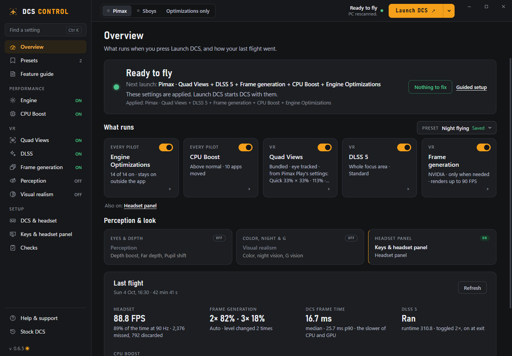
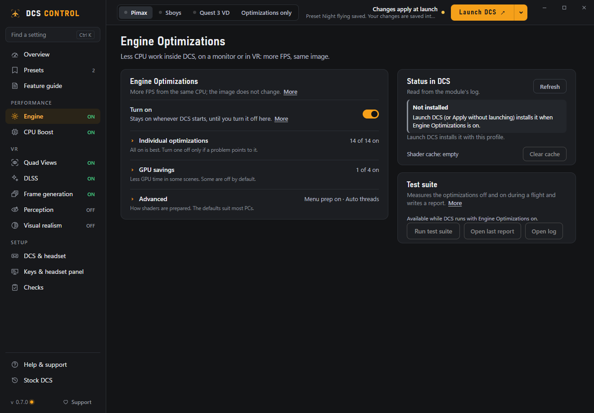
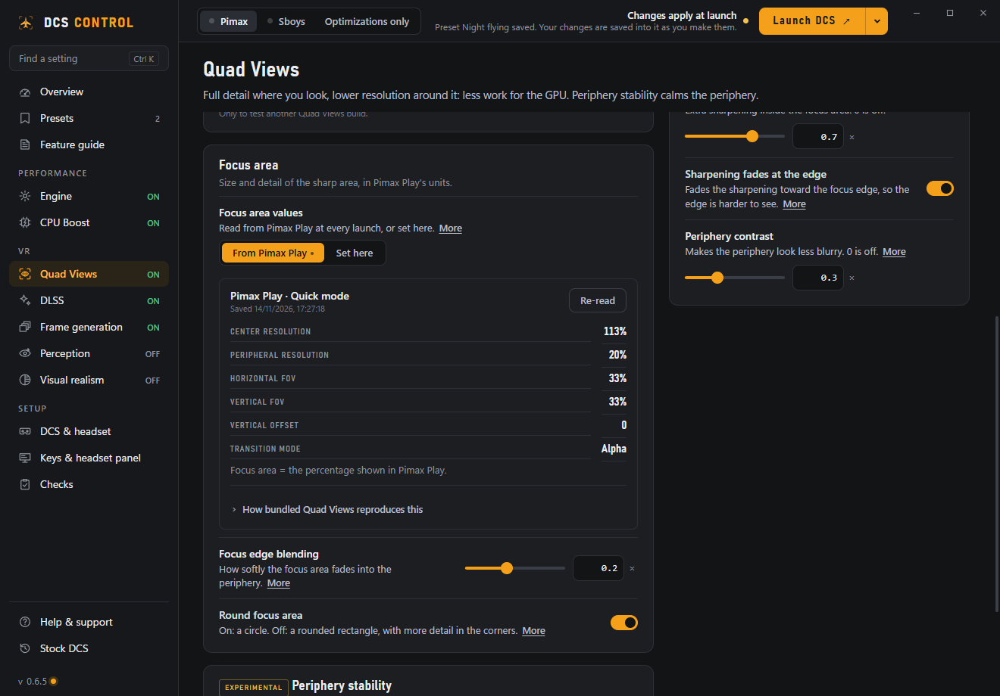
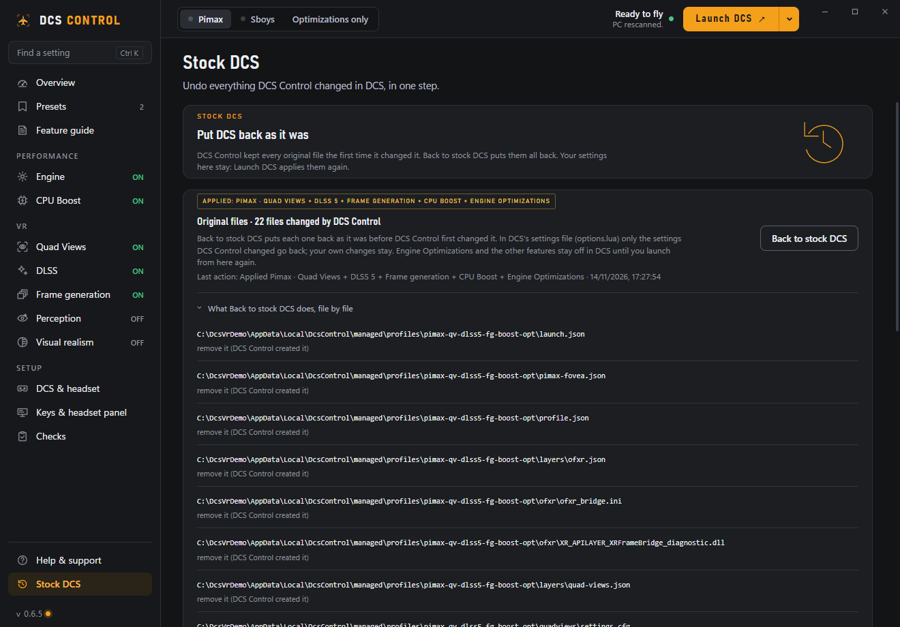

# DCS Control

A free Windows app that makes DCS World run faster, on a monitor or in any headset, and runs **DLSS 5, frame generation and Quad Views foveated rendering together in VR**, set up and launched with one button.

- **Every pilot** (monitor, Quest, Varjo, Reverb, Pimax…): **Engine Optimizations** take CPU work off DCS without changing the image: about **+50-60 % FPS** at a busy airfield when DCS is CPU-bound. Once applied they stay on every time DCS starts, also from Steam or a desktop shortcut.
- **Pimax pilots** (Pimax Play, or SteamVR with Sboys) get the full VR pipeline: **Quad Views** (eye-tracked foveated rendering), **DLSS 5** (NVIDIA neural rendering on the area you look at) and **frame generation** (OFXR, only while DCS falls behind), working together, with an in-headset panel that shows what each one does.
- **Quest 3 pilots** streaming with Virtual Desktop get Quad Views with a fixed focus area, frame generation and the engine optimizations.

Everything the app changes in DCS is backed up and comes back with one button, **Back to stock DCS**.

> **Early beta.** Flown mostly on one PC so far (Pimax Crystal Super, RTX 5090, Windows 11, DCS 2.9 Steam, single player), so expect rough edges. It was built with an AI coding assistant. Bug reports are very welcome: see [Reporting a problem](docs/USER_GUIDE.md#reporting-a-problem).

<p align="center">
  
</p>

| Engine Optimizations (every pilot) | Quad Views, read from Pimax Play | Back to stock DCS |
| --- | --- | --- |
|  |  |  |

## What's new in 0.7

**New in 0.7.0:** 0.6.7 was never released, so coming from 0.6.6 all of this is new. Full list: [release notes](docs/RELEASE_NOTES.md).

- **Foveated frame generation** (experimental, off by default): the focus area and the rest of the view get their generated frames separately, for less than half the GPU time and less video memory.
- **Quest 3 VD**: a new route for a Meta Quest 3 through Virtual Desktop (VDXR), contributed by @Mav87th in GitHub PR #29.
- **Hide the focus edge** (on by default): the short flash at the edge of the focus area when you look somewhere else is much smaller.
- **Eye-tracking options** from @Heartbreak-1 (GitHub PR #26): **Soft focus edge**, **Stay ahead until your eyes land** and **Slide back when tracking is lost** (experimental).
- **Go back** to the version you had before an update.
- **Less CPU**: the terrain prefetch fix no longer lets DCS's terrain threads spin (about 45 % less DCS CPU in test flights).
- **Smooth mouse cursor** now works in the cockpit.
- **Pimax's Quad View presets** render as Pimax renders them, and a **Vertical offset** moves the focus area up or down.
- **A stuck or crashed DCS** shows on every page, with **End DCS**, also for a DCS running as administrator.
- **GPU savings** on the Engine page: **Skip hidden water** and **Skip unused effects** (experimental, off by default).
- **Both eyes at once** for frame generation and **Match brightness** for DLSS 5 (both off by default).
- **Lighter pages**: each card shows its main settings, the rest sit in folds that say what is set.
- More settings apply in flight, fewer requirements for Sharp HUD, Far depth, Pupil shift and Eye-focus blur, the Vertical offset requested in GitHub #24, and fixes for GitHub #21, #27 and #30-#33.

## What it does

**For every pilot, on a monitor or with any headset**

- **Engine Optimizations:** a small module DCS loads by itself from Saved Games. It takes CPU work off DCS's render and model threads (multi-threaded G-buffer and shadows, faster culling, leaner memory and state handling) and leaves the image exactly the same. Measured at a busy airfield in VR (in 0.5): about **+50-60 % FPS** and **p95 frame time −34 %**. How much you gain depends on how CPU-bound you are. It also fixes a DCS terrain loop that wastes CPU time.
- **GPU savings** on the same page: Faster terrain and shader paths (on), and Cache distant shadows, Skip hidden water and Skip unused effects (experimental, off by default).
- **CPU Boost:** gives DCS priority and its fastest cores while it runs.
- **Free VRAM:** closes memory-hungry apps before the flight and reopens them after.

Not on a Pimax or a Quest 3? Choose **Optimizations only**: DCS runs exactly as you set it up (monitor, or your headset with its own software) and the app adds only these.

**For Pimax headsets (Pimax Play, or SteamVR with Sboys), and a Quest 3 through Virtual Desktop**

- **Quad Views (foveated rendering):** sharp where you look, lighter in the periphery, eye-tracked. It uses the focus area you set in Pimax Play, at the percentages Pimax Play shows (Horizontal FOV 25% = a sharp area 25% of the view wide). Keep Quad Views on in Pimax Play: the bundled Quad Views takes over from it for DCS. **Hide the focus edge** keeps the edge of the focus area quiet when your eyes move.
- **DLSS 5 (DLSS-NR neural rendering)** on the focus area only, optionally just its central part to save GPU time, with an in-flight key to compare. **DLSS presets** choose the DLSS model for the focus area, and optionally a lighter one for the periphery (about 0.3 ms faster).
- **Frame generation (OFXR):** DCS renders at the headset's refresh rate and frames are generated only while it falls behind (2× or 3×, picked automatically), so there is no added latency while DCS keeps up. **Sharp HUD** (experimental) keeps HUD symbols from smearing in generated frames; **Foveated frame generation** (experimental) halves the GPU time of generated frames.
- **Perception** (experimental, off by default): Pupil shift, Depth boost, Far depth and Periphery stability, for more natural depth and steadier edges.
- **Visual realism** (off by default): color fixes for DCS in VR, a correction for the Crystal Super's wide-gamut panels, night vision, light glare, eye-focus blur (experimental) and G vision loss, each for 0.04-0.18 ms of GPU time.
- **On the Quest 3** (Virtual Desktop, VDXR): Quad Views with a fixed focus (the Quest 3 has no eye tracking), frame generation and the engine optimizations. DLSS 5 is offered but not yet tried on this route.
- **VR helpers:** a small DCS window on the monitor, a lower monitor mode while you fly, the in-headset panel (FPS, frame-generation mode, DLSS state, VRAM).

After each flight the Overview shows a **Last flight** summary.

## Requirements

- **Windows 10 or 11, 64-bit** (tested on 11) and **DCS World 2.9** (tested on 2.9.30 and 2.9.31), Steam or standalone.
- **Engine Optimizations and CPU Boost** run with any graphics card. On AMD Radeon cards the multi-threaded shadows and G-buffer stay off by default (the driver lacks D3D11 command lists), so the gain is smaller; an opt-in runs them on lists Windows emulates. Radeon cards have not been tested yet.
- **For the VR features:** an NVIDIA RTX graphics card, and either a Pimax headset with Pimax Play (or SteamVR with the Sboys driver), or a Meta Quest 3 with Virtual Desktop.
- **For DLSS 5:** your own NVIDIA-signed `nvngx_dlssnr.dll`, version 310.8 (tested most) or 310.9. It is not included: NVIDIA does not offer it for download on its own, and DCS Control cannot provide it or point you to one.
- The setup installs the Microsoft WebView2 Runtime and the Visual C++ x64 runtime from Microsoft if they are missing.

## Install

1. Download `DcsControl-0.7.0-preview-Setup.exe` from [Releases](https://github.com/NIGos/dcs-control/releases) and double-click it. It installs DCS Control for your Windows user (no administrator rights) in the folder you choose, with Start menu and desktop shortcuts, then opens it. Windows may say the publisher is unknown: choose More info → Run anyway.
2. Or take `DcsControl-0.7.0-preview-win-x64.zip` for a portable copy: unzip it anywhere and double-click `DcsControl.exe` (keep the `files` folder next to it).

The app tells you when a newer release is out and updates itself after checking the release signature. Uninstall it from Settings → Apps; press **Back to stock DCS** first. Details: [Install](docs/USER_GUIDE.md#install).

## First flight

1. **Choose how you fly** in the top bar: **Pimax**, **Sboys**, **Quest 3 VD**, or **Optimizations only** (monitor or another headset). **Guided setup** on the Overview, or **Read settings from this PC** on the DCS & headset page, can do it for you.
2. **Switch on the features** you want under **What runs** on the Overview. Each one has its own page if you want to adjust it.
3. **Start your headset software** and press **Launch DCS**.

Engine Optimizations then stay on whenever DCS starts. The VR features and CPU Boost need DCS to be started from the app.

## Documentation

- **[User Guide](docs/USER_GUIDE.md)**: every page of the app in order, what each feature costs, the in-flight keys, and what to do when something goes wrong.
- **[Release notes](docs/RELEASE_NOTES.md)**: what changed in each version.
- From 0.6 (the pages have changed since): the **[User Manual (PDF)](https://github.com/NIGos/dcs-control/releases/download/v0.6.5-preview/DcsControl-0.6.5-User-Manual.pdf)** for 0.6.5, the [5-minute video tour](https://youtu.be/hPQD7im2VKc) and [What's new in 0.6](https://youtu.be/m8BVXMIsXN8) on YouTube.

## Good to know

- **Multiplayer is at your own risk.** Only single player is tested. With DLSS 5 or Foveated Super Resolution the app places a `dxgi.dll` loader and Cheeky's files in DCS's `bin` folder; with Engine Optimizations, and with frame generation in VR, Depth boost, Far depth or the Visual realism effects, it adds a hook and a module in `Saved Games\DCS\Scripts`. Without DLSS 5 nothing in the DCS install changes. Integrity Check has not been tested; if a server refuses you, use Back to stock DCS before joining it.
- **Frame generation adds latency while it generates frames**, more in 3× than in 2×. With *Only when needed* (the default) that happens only while DCS can't keep up; DCS Control sets DCS's frame limit to the refresh rate for it. The mouse cursor moves at DCS's own frame rate unless **Smooth mouse cursor** is on.
- **Try new features one at a time.** Visual realism, Sharp HUD, the Perception features, foveated frame generation and the Engine page's experimental GPU savings are off by default. Turn them on one by one and tell us what you see.
- **Pimax Play changed its scales in 2026-10.** DCS Control reads the new ones. If you came from 0.5.10, your bundled Quad Views focus may look smaller with the same Pimax Play sliders: raise Horizontal/Vertical FOV there.
- **Start the app from the Start menu or Explorer**, not as administrator.
- **Updates**: the app asks GitHub for a newer release at most every 6 hours (you can turn this off on the Help & support page). It installs only a setup signed with the release key built into the app.
- **Before updating or repairing DCS**, close it and use **Back to stock DCS**.
- **Formerly DCS VR Control.** The app was renamed in 0.5.0. Installing it replaces the old install; your backups and profiles are kept.

## Credits and licences

DCS Control's own code is licensed under the GNU General Public License v3.0 or later ([LICENSE](LICENSE)). It builds on other people's work, each under its own licence:

- **Quad-Views-Foveated** by mbucchia (MIT)
- **CheekyFoveatedDLSS** (GPL-3.0), with local changes for the Quad Views focus views
- **OFXR Bridge** by tig3rmast3r and the **djules75 fork** (LGPL-3.0-or-later), with local patches
- **Sboys CustomHeadsetOpenVR** (GPL-2.0 source; downloaded from its official release, not bundled)
- **AMD FidelityFX SDK** (MIT), **Microsoft .NET** and the **WebView2 SDK**

Code contributions in 0.7: the Quest 3 VD route from @Mav87th (GitHub PR #29) and the eye-tracking options from @Heartbreak-1 (GitHub PR #26). Thank you.

The NVIDIA DLSS runtime is not included. Every release has a sources ZIP with the complete corresponding source. Details are in [docs/THIRD_PARTY.md](docs/THIRD_PARTY.md). DCS World is a trademark of Eagle Dynamics; Pimax, NVIDIA and DLSS are trademarks of their owners. This project isn't affiliated with any of them.

## Support

Feedback and bug reports go in [Issues](https://github.com/NIGos/dcs-control/issues). If the app saves you some frames and you'd like to buy me a coffee: [ko-fi.com/nigos](https://ko-fi.com/nigos). Thank you!

---

## For developers

### How it fits together

DCS (DX11) → Cheeky (DLSS 5 on the Quad Views focus views, D3D11↔D3D12 transport) → bundled Quad-Views-Foveated → OFXR frame generation → Pimax OpenXR runtime (or SteamVR with Sboys, or Virtual Desktop's VDXR). The app gives the DCS process a private OpenXR runtime and layer environment, so nothing is registered globally. The design and the alternatives that were tried are in [docs/APPROACHES.md](docs/APPROACHES.md); performance measurements are in [docs/PERFORMANCE.md](docs/PERFORMANCE.md) and frame pacing in [docs/FRAME_PACING.md](docs/FRAME_PACING.md).

Third-party changes are kept as reproducible patches: `scripts/patch-cheeky.py` with `patches/cheeky`, `patches/ofxr-djules75/*.patch` applied by `scripts/build-ofxr-djules75.ps1`, and `patches/quadviews/*.patch` applied by `scripts/build-quadviews.ps1`. The DCS engine optimizations (DcsQvCull, with the terrain prefetch fix) are in `native/dcsqvcull`.

The unattended flight rig that tests frame generation in a real DCS (a capture layer, scenarios and verdict scripts) is in [tools/rig](tools/rig/README.md). Nothing of it is shipped. Branches, worktrees, the quiet lock and what a release is built from are in [docs/DEVELOPING.md](docs/DEVELOPING.md).

### Original files and recovery

The first time the app writes a path it backs up the original (or notes that there was none) under `%LOCALAPPDATA%\DcsControl\originals`. Later launches simply overwrite. **Back to stock DCS** puts every path back: backups are written back, new files are removed, and in `options.lua` only the settings the app changed are restored. Only a running DCS blocks it.

### Build and test

```powershell
./scripts/bootstrap-sdk.ps1
./scripts/fetch-integrations.ps1
./scripts/build-upstream.ps1 -Component cheeky
./scripts/build-ofxr-djules75.ps1
./scripts/build-quadviews.ps1
./scripts/build-dcsqvcull.ps1
./.tools/dotnet/dotnet.exe run --project tests/DcsVr.Tests -c Release
./scripts/build-release.ps1
./scripts/test-release.ps1
```

Build scripts pin upstream revisions. Tests use isolated DCS fixtures and never start DCS. Python scripts run with the Python launcher (`py -3 scripts/<name>.py`; `scripts/python.ps1` is the resolver for PowerShell scripts): on a PC without Python on PATH, plain `python` is only the Microsoft Store stub. `scripts/build-upstream.ps1 -Component cheeky` still calls plain `python` until Cheeky is next rebuilt (the script is an input of Cheeky's build stamp).

`py -3 scripts/package-sources.py` builds the corresponding-source ZIP: the tracked files of this repository and the patched upstream trees in `external\`. It stops when the working tree has uncommitted changes or untracked files (`--allow-dirty` packs anyway, `--include-untracked` adds the untracked files), and when Quad Views, OFXR or Cheeky in `external\` were not built from the scripts and patches checked out (`scripts/assert-components-current.ps1`): `external\` holds whatever was built last, on any branch.

`build-release.ps1` also makes `DcsControl-<version>-Setup.exe` (`native/setup`, built by `scripts/build-setup.ps1`, with the release ZIP appended) and signs the setup and the ZIP with `scripts/sign-release.ps1`: `<file>.sig` is the base64 of an ECDSA P-256 / SHA-256 signature in IEEE P1363 form, made with the private key in `%USERPROFILE%\.dcs-control-signing\release-signing-key.pem` (never in the repository or a release) and checked against the public key in `src/DcsVr.Core/Updates.cs`. Without the key a developer build warns and stays unsigned; `build-release.ps1 -Sign` fails instead. Publish the setup and the ZIP with their `.sha256` and `.sig` files, and the sources ZIP with its `.sha256` (it is not signed), with the release; the in-app updater needs `DcsControl-<version>-Setup.exe` and `DcsControl-<version>-Setup.exe.sig`. More: [validation](docs/VALIDATION.md), [adapter contracts](docs/QUAD_FOCUS_ADAPTER.md), [interface notes](docs/INTERFACE.md), [third-party components](docs/THIRD_PARTY.md).

### Command line

```powershell
./DcsVr.Cli.exe inventory
./DcsVr.Cli.exe validate --profile profile.json
./DcsVr.Cli.exe preview --profile profile.json
./DcsVr.Cli.exe status
./DcsVr.Cli.exe launch
./DcsVr.Cli.exe restore
```

`preview` only writes a private staging cache; `apply`, `launch` and `restore` change files. Commands that use the app's state refuse to run when Windows redirects `%LOCALAPPDATA%` into another app's package (pass `--state` to choose a folder).

### Documentation screenshots

The images in `docs/screenshots` are rendered by the app itself with a neutral demo layout, so no real user path appears. Run a release build of `DcsControl.exe` (DCS is not needed):

```powershell
$env:WEBVIEW2_ADDITIONAL_BROWSER_ARGUMENTS = '--force-device-scale-factor=1'
$env:DCSVR_SMOKE_DEMO_ROOT = 'C:\DcsVrDemo'
$env:DCSVR_SMOKE_DOC_VIEWS = '1'
$env:DCSVR_TEST_NEURAL_PATH = 'C:\DcsVrDemo\Downloads\nvngx_dlssnr.dll'
./DcsControl.exe --web-smoke <output-folder>\interface
```

`overview-what-runs.png` is the `overview-changes-apply.png` view. The views show the top of each page at 1320×920.
