# DCS Control — User Guide

**Version 0.7.1-preview (early beta).** This guide is for pilots. It explains what the app does, how to set it up and how to get help. Developer documentation lives in the [README](../README.md#for-developers) and the other files in `docs/`. A printable book with a Quick Start and numbered screenshots: **[User Manual (PDF)](https://github.com/NIGos/dcs-control/releases/download/v0.7.0-preview/DcsControl-0.7.0-User-Manual.pdf)**.

> **Early beta.** DCS Control has been flown mostly on one PC (Pimax Crystal Super, RTX 5090, DCS 2.9 Steam edition). Expect rough edges. Every file it changes is backed up and can be put back with one click (**Back to stock DCS**), so trying it is safe. Please read [Requirements](#requirements) and [Launch DCS](#launch-dcs) before your first flight.

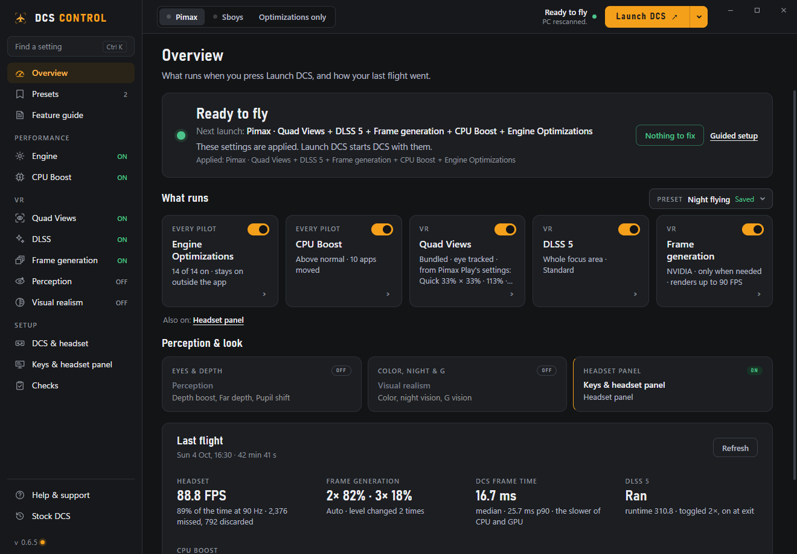

## Contents

- [New in 0.7.1](#new-in-071) and [New in 0.7](#new-in-07)
- [What the app does](#what-the-app-does)
- [Requirements](#requirements)
- [Install](#install) and [Updates](#updates)
- [First run](#first-run): [Read settings from this PC](#read-settings-from-this-pc), [Guided setup](#guided-setup), [The window](#the-window), [Optimizations only](#optimizations-only-any-other-headset-or-no-vr), [Quest 3 through Virtual Desktop](#quest-3-through-virtual-desktop)
- [The pages](#the-pages), in the order of the left rail:
  [Overview](#overview),
  [Presets](#presets),
  [Feature guide](#feature-guide),
  [Engine Optimizations](#engine-optimizations),
  [CPU Boost](#cpu-boost),
  [Quad Views](#quad-views),
  [DLSS](#dlss),
  [Frame generation](#frame-generation),
  [Perception](#perception),
  [Visual realism](#visual-realism),
  [Audio](#audio),
  [DCS & headset](#dcs--headset),
  [Keys & headset panel](#keys--headset-panel),
  [Checks](#checks),
  [Help & support](#help--support),
  [Stock DCS](#stock-dcs)
- [Launch DCS](#launch-dcs) and [Live changes while DCS runs](#live-changes-while-dcs-runs)
- [Troubleshooting and FAQ](#troubleshooting-and-faq)
- [Reporting a problem](#reporting-a-problem)
- [Support](#support)

## New in 0.7.1

- **3D headphone audio** (Audio page, experimental, off by default): real 3D sound for headphones, in VR and on a monitor. **Cockpit space** (Subtle by default) puts cockpit sounds around you instead of inside your head. See [Audio](#audio).
- **Cleaner generated frames** (Frame generation page, Image quality > **Fine-tune**, experimental, NVIDIA only, all off by default): four options for cleaner edges around your aircraft in the external view; little effect in the cockpit. See [Frame generation](#frame-generation).
- **Multi-threading without driver support** is on by default with AMD graphics (GitHub #27); NVIDIA PCs keep their choice.
- **Ultraleap hand tracking** no longer crashes DCS at start with Quad Views and frame generation (GitHub #35). See the [release notes](RELEASE_NOTES.md).

## New in 0.7

0.6.7 was never released, so coming from 0.6.6 everything below is new.

- **Foveated frame generation** (Frame generation page, experimental, off by default): the focus area and the rest of the view get their generated frames separately, for less than half the GPU time and less video memory. Pimax and Quest 3 VD routes. See [Frame generation](#frame-generation).
- **Quest 3 VD**, a new route in the top bar: a Meta Quest 3 streamed by Virtual Desktop (VDXR), with Quad Views at a fixed focus, frame generation and the engine optimizations. Contributed by @Mav87th in GitHub PR #29. See [Quest 3 through Virtual Desktop](#quest-3-through-virtual-desktop).
- **Hide the focus edge** (Quad Views page, Focus area card, on by default): the short flash at the edge of the focus area when you look somewhere else is much smaller.
- **Eye-tracking options** from @Heartbreak-1's GitHub PR #26: **Soft focus edge** (experimental, off by default; under **Hide the focus edge** > **Fine-tune**, needs edge blending and Hide the focus edge on), **Stay ahead until your eyes land** and **Slide back when tracking is lost** (both experimental, on by default). They also work with frame generation.
- **Go back** (Help & support, Updates): returns to the version you had before an update. An earlier version cannot open profiles or presets saved by 0.7; Go back handles that for you. See [Updates](#updates).
- **Less CPU**: the terrain prefetch fix no longer lets DCS's terrain threads spin (about 45 % less DCS CPU in test flights), and after an update the shaders are prepared with one thread while you fly.
- **Smooth mouse cursor** now works in the cockpit.
- **Pimax's Quad View presets** are rendered by the bundled Quad Views, the page shows the real focus size, and **Vertical offset** moves the focus area up or down (Quad Views page, *Set here*; GitHub #24).
- **A stuck DCS** (no window, not responding, crashed) shows at the top of every page with **End DCS**, which also ends a DCS running as administrator (GitHub #21).
- **GPU savings** fold on the Engine Optimizations page: **Skip hidden water** and **Skip unused effects** (experimental, off by default) next to Cache distant shadows. **Faster terrain and shader paths** (on by default, now in the same fold) can be turned off if a problem points to it.
- **Both eyes at once** (Frame generation page, experimental, off by default): each eye's generated frame on its own GPU queue, ready about 1 ms sooner. It has had less testing than the rest.
- **Match brightness** for DLSS 5 (off by default) keeps the DLSS 5 area as bright as the view around it. The Focus and Periphery DLSS presets now also work with DLSS 5.
- **More settings apply in flight**: Hide the focus edge, the eye-tracking options, Far depth's strength and key, the headset panel's position, the FPS and VRAM counters, the new engine settings, and the DLSS presets (from the next mission start). See [Live changes while DCS runs](#live-changes-while-dcs-runs).
- **Fewer requirements**: Sharp HUD no longer needs Depth boost. Sharp HUD, **Far depth** and frame generation's cockpit outline, depth and motion also run with Engine Optimizations off. **Pupil shift** and **Eye-focus blur** also work with a fixed focus area or without Quad Views, from the headset's own eye tracking (Pimax; not flown yet). Eye-focus blur is off in DCS's main menu.
- **Lighter pages**: each card shows its main settings; the rest sit in folds whose closed line says what is set. Experimental settings carry an **EXPERIMENTAL** tag. See [The pages](#the-pages).
- **AltGr+Shift+F11** works as the in-flight switch, and AltGr no longer counts as Ctrl+Alt. The engine's test suite also runs on a headset without quad views (it compares whole frames).
- Fixes for GitHub issues #27, #30, #31, #32 and #33. See the [release notes](RELEASE_NOTES.md).

## What the app does

DCS Control makes DCS World faster and, on Pimax headsets, runs **DLSS 5 + frame generation + Quad Views together in VR**, set up and launched with one button, without you copying files by hand. It was called **DCS VR Control** before 0.5.0; it is no longer only for VR.

**For every pilot, on a monitor or with any headset**

| Feature | What you get |
| --- | --- |
| **Engine Optimizations** | A small module DCS loads by itself from Saved Games takes CPU work off DCS's render and model threads, with exactly the same image: about +50-60 % FPS at a busy airfield when DCS is CPU-bound. It also fixes a DCS terrain loop that wastes CPU. Once applied it stays on every time DCS starts, also from Steam or a desktop shortcut. |
| **CPU Boost** | Gives DCS priority and its best CPU cores while it runs, and keeps background apps off those cores. Plus Free VRAM before flight. |

Not on a Pimax or a Quest 3? Choose **Optimizations only** in the top bar: DCS runs exactly as you set it up and the app adds only these two (see [Optimizations only](#optimizations-only-any-other-headset-or-no-vr)).

**For Pimax headsets (Pimax Play, or SteamVR with Sboys), and a Quest 3 through Virtual Desktop**

| Feature | What you get |
| --- | --- |
| **Quad Views** | Foveated rendering: DCS draws a sharp *focus* area where you look (eye tracked or fixed in the centre) and a lower-resolution periphery. Uses the focus values you already set in Pimax Play. |
| **DLSS 5** | NVIDIA's DLSS-NR neural rendering, applied to the Quad Views focus area on DCS's own DLSS (you bring the NVIDIA runtime file). Without Quad Views, optional Foveated Super Resolution (Cheeky) saves GPU outside where you look. |
| **Frame generation** | OFXR optical-flow frame generation: DCS renders half (or a third) of the headset refresh rate and generated frames fill the rest. |

On the **Quest 3 VD** route the Quest 3 has no eye tracking, so the Quad Views focus area stays in the centre, and the features that follow your eyes are off (see [Quest 3 through Virtual Desktop](#quest-3-through-virtual-desktop)).

You switch on the features you want on the Overview, adjust them on their pages if you like, and press **Launch DCS**. The app writes the needed files into DCS (backing up the originals the first time), starts DCS, and puts everything back when you press **Back to stock DCS**. What stays on without the app: Engine Optimizations, terrain prefetch fix included. What needs DCS started from the app: the VR features and CPU Boost's priority and cores.

What it does **not** do: it does not change Windows settings, your GPU driver settings, your global OpenXR runtime or your DCS graphics settings (apart from a few listed `options.lua` values such as the frame limit with the VR features, which it restores). It does not add NVIDIA DLSS Frame Generation to DCS; frame generation here is OFXR's optical flow.

## Requirements

- **Windows 10 or 11, 64-bit** (tested on Windows 11; Windows 10 is supported by everything the app uses but has not been flown yet). Run as a normal user — not as administrator.
- **For Engine Optimizations and CPU Boost:** any GPU and headset, or none. On **AMD Radeon** cards the driver does not offer D3D11 command lists, so the multi-threaded shadows and G-buffer run on lists Windows emulates (**Multi-threading without driver support**, on by default), with a smaller gain than on NVIDIA ([details](#multi-threaded-shadows-and-g-buffer-are-unavailable)). Tested on a Radeon RX 7900 XTX. The items below are for the VR features.
- **NVIDIA RTX graphics card** for DLSS 5 and for NVIDIA optical-flow frame generation. (The Frame generation page also offers FidelityFX, which works on any GPU, but the tested setup is NVIDIA.) Development and testing: RTX 5090.
- **Pimax headset** (tested: Crystal Super Micro OLED) with either
  - **Pimax Play** (the original Pimax OpenXR runtime), or
  - **SteamVR with the Sboys driver** (CustomHeadsetOpenVR 1.3.0; for SLAM tracking it needs Pimax EVO).
- Or a **Meta Quest 3** with **Virtual Desktop** and its OpenXR runtime, **VDXR** (tested by a contributor with an RTX 5070 Ti; DLSS 5 has not been tried on this route).
- **DCS World 2.9**, Steam edition or standalone.
- **Microsoft Edge WebView2 Runtime** (already on most Windows 10 and 11 PCs) and the **Microsoft Visual C++ x64 runtime 14.50 or newer**. The setup (and `Install DCS Control.cmd`) checks both and installs them from Microsoft if they are missing.
- For DLSS 5: your own signed NVIDIA **`nvngx_dlssnr.dll`, version 310.8 or 310.9** (see [DLSS 5](#dlss)). It is not included, the app does not download it, and NVIDIA does not offer it for download on its own. NVIDIA's runtime officially runs on RTX 50 cards; on RTX 20, 30 and 40 cards, NVIDIA's file changed by a community compatibility patch is accepted too.

## Install

**With the setup (recommended):** download `DcsControl-0.7.1-preview-Setup.exe` from the [Releases page](https://github.com/NIGos/dcs-control/releases) and double-click it. Its first page lets you choose:

- the **install folder**: `%LOCALAPPDATA%\Programs\DcsControl` unless you pick another one with **Browse...** (it shows the space needed and free). Any folder your Windows user can write to works, for example `D:\Games\DcsControl`; `Program Files` needs administrator rights, so it is refused. A folder that already holds other files gets a `DcsControl` folder inside it;
- whether DCS Control goes in the **Start menu** and on the **desktop**.

**Install** then checks the files it carries, installs WebView2 / the C++ runtime from Microsoft if they are missing (this step may need internet access and an administrator prompt for the C++ runtime), installs DCS Control for your Windows user (no administrator rights) with an entry in **Settings → Apps → Installed apps**, and offers to open it.

It waits until DCS and DCS Control are closed (the page says which one is still open). Running it again over an installed copy updates it in place; if anything goes wrong the installation is rolled back to the version you had. Its log is `%TEMP%\DcsControl-Setup.log`.

**Portable, from the ZIP:** download `DcsControl-0.7.1-preview-win-x64.zip` and extract it to a folder of your choice. Then either:

- **Run it directly:** double-click `DcsControl.exe` in the extracted folder (.NET is included), or
- **Install it:** double-click `Install DCS Control.cmd`. It does what the setup does, in a console window, with the Start menu entry but no desktop shortcut.

The folder contains only three things: **`DcsControl.exe`** (the app), **`Install DCS Control.cmd`** and a **`files`** folder with everything else (keep it next to `DcsControl.exe`), plus a short `README.txt`. The folder can be anywhere: Desktop, Downloads, another drive. The app keeps its own data (backups, profiles) in `%LOCALAPPDATA%`, so moving the folder loses nothing.

**How the app finds DCS:** the standalone version from Windows' list of installed programs ("DCS World", also OpenBeta), the Steam version from your Steam libraries, and your settings from `Saved Games\DCS` (or `DCS.openbeta`). If it finds nothing, or you have more than one install, pick `DCS.exe` and `options.lua` on the **DCS & headset** page.

If you had **DCS VR Control** installed (the app's name before 0.5.0), the setup (or `Install DCS Control.cmd`) replaces it and its Start menu entry; your backups and profiles stay where they are and Back to stock DCS keeps working.

Installing the app does not touch DCS or your VR software. Nothing is written into DCS until you press **Launch DCS** (or **Apply without launching**).

The preview is not code-signed, so Windows SmartScreen may warn you the first time you open it.

> **Always open the app from the Start menu or from Explorer**, not from a script runner or another program's terminal. See [the DCS launcher option](#the-dcs-launcher-option) for why.

## Updates

When DCS Control starts it asks GitHub whether a newer release is out (at most every 6 hours, or 30 minutes after a check that failed; only the list of releases is fetched, nothing about your PC is sent). When there is one, the **Overview** shows **DCS Control *version* is available** with:

- **What's new**: that release's notes;
- **Update**: downloads the release's setup, checks its **signature** against the release key built into the app and that it is the version announced (a download that does not match is deleted and nothing is installed), closes DCS Control, installs the new version in the same folder and starts it again. Your profiles, backups and the applied profile stay as they are. **Cancel download** (or closing the dialog) stops the download; a download that receives nothing for a minute stops by itself.

Update refuses while DCS runs and while Launch DCS, Apply or Back to stock DCS is still working. If the update fails, the installation rolls back and the DCS Control you had opens again. A copy started from an unzipped folder is updated by installing DCS Control where the setup installed it before (Settings → Apps knows), otherwise in the standard folder (`%LOCALAPPDATA%\Programs\DcsControl`, with Start menu and desktop shortcuts); the dialog names the folder, and afterwards you can delete the unzipped one.

Releases before 0.5.6 cannot update themselves: install 0.5.6 once with the setup (or the ZIP); from then on updates arrive in the app. **0.6.3 has a new release signing key**: from 0.6.2 or earlier, **Update** refuses it ("the signature does not match DCS Control's release key") and installs nothing, so install 0.6.3 or later (for example 0.7.0) once with its setup; your settings and profiles are kept, and later updates install from the app again. A dot next to the version number at the bottom of the left rail also means an update is available; × hides the banner until the next start.

On the **Help & support** page, under **Updates**, **Check for updates when DCS Control starts** turns the automatic check off (it is on by default) and **Check now** asks GitHub at once. Without internet nothing happens: no update is shown.

**Go back**, at the bottom of the same card, returns to the version you had before the last update, for when an update gives you trouble. Close DCS first. DCS is put back to stock, then the earlier version's own signed setup installs it again (from 0.7 on it is kept on your PC for a month after an update; otherwise, as when you came from 0.6.6 or earlier, it is downloaded) and DCS Control restarts. A version from before 0.7 shows its own update banner again after a few hours. Your settings return to how they were in that version; the ones you changed since stay in `%LOCALAPPDATA%\DcsControl\versions`, and presets you saved since come back when you update again. It goes one step back only, and not to versions before 0.6.3. The update you left is not offered again by itself; **Check now** shows it.

**From 0.7 back to an earlier version** (0.6.6, for example). An earlier version cannot open a profile or preset saved by 0.7: it refuses the settings that are new in 0.7. Go back takes care of this: DCS is put back to stock, and the earlier version gets back the settings and presets you had in it (the copy taken when 0.7 was installed). If there is no such copy, it starts with its default settings. Your 0.7 settings and presets are kept in `%LOCALAPPDATA%\DcsControl\versions`, and the presets come back when you update again. A file you exported from 0.7 (**Export to a file**) cannot be imported in an earlier version.

**What's new** after an update: the first start of a new version shows its release notes once. Click the version number at the bottom of the left rail (or **What's new in this version** on the Help & support page) to see them again.

## First run

Pick **how you fly** in the top bar: **Pimax** (Pimax Play), **Sboys** (SteamVR with the Sboys driver), **Quest 3 VD** (a Quest 3 through Virtual Desktop) or **Optimizations only** (a monitor, or any other headset with its own software). **Read settings from this PC** or **Guided setup** can choose it for you and fill in the rest. Not sure what to turn on? The **[Feature guide](#feature-guide)** page explains every feature in a few lines.

### Read settings from this PC

Click **Read settings from this PC** at the top of the **DCS & headset** page. The app looks at what runs on your PC and proposes a profile: the headset route (Pimax Play, SteamVR with Sboys, or Virtual Desktop with VDXR as the active OpenXR runtime), eye tracking, the refresh rate SteamVR uses, your Pimax Play Quad View values and a valid DLSS 5 runtime file (it looks in Downloads, Documents and Desktop). Each value shows where it came from; nothing changes until you accept. When Virtual Desktop and Pimax Play both run, it picks no route and asks you to close the one you are not flying with, then read again.

### Guided setup

Or click **Guided setup** for three short steps. It is on the Overview (a **First time? Guided setup** button until you first launch or apply a profile, a small link afterwards) and at the top of the **DCS & headset** page:

1. **Choose** — how you fly (Pimax, Sboys, Quest 3 VD, or Optimizations only for a monitor or another headset), the features you want and, with Quad Views, whether the focus follows your eyes or stays centred. Your quality settings are kept.
2. **Check** — the app checks files, the VR runtime, package hashes, the DLSS runtime file and (on Sboys) the driver and gaze bridge. Problems are listed first, under **Must fix** and **Check yourself** as on the Checks page; **DCS files** lets you pick `DCS.exe` and the DCS settings file (`options.lua`). Nothing is written in this step.
3. **Fly** — start your headset software, then press **Launch DCS**.

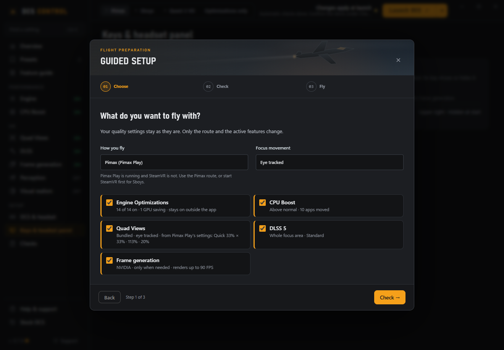

Closing the wizard before **Launch DCS** writes nothing.

### The window

- **Top bar**: **how you fly** (**Pimax**, **Sboys**, **Quest 3 VD** or **Optimizations only**; a dot marks the VR software that is running, and the app warns you if your settings use another one), the status in one line, and **Launch DCS**, the one button you need. When a running DCS looks stuck, the status says **DCS has no window**, **DCS is not responding** or **DCS has crashed** and offers **End DCS** (see [DCS doesn't start](#dcs-doesnt-start)). The arrow beside Launch DCS opens **Review files** (what Launch will write, read-only), **Apply without launching** and, once DCS Control has changed files, **Stock DCS**. While DCS runs, the **Live** switch turns live changes on or off ([Live changes](#live-changes-while-dcs-runs)).
- **Left rail**: **Overview**, **Presets** and **Feature guide**, then three groups: **Performance** (Engine, CPU Boost), **VR** (Quad Views, DLSS, Frame generation, Perception, Visual realism; hidden with Optimizations only) and **Setup** (DCS & headset, Keys & headset panel, Checks). **Help & support** and **Stock DCS** sit at the bottom, with the version number (click it for What's new). Next to each feature the rail says **ON** or **OFF**. In a narrow window it shows icons only.
- **Settings**: each shows one sentence; **More** opens the rest. A greyed-out setting says under its name what it is waiting for, often with a button that takes you there.

Everything you change is saved as you change it and kept across app restarts; there is no Save button. Nothing is written to DCS until you press **Launch DCS** (or **Apply without launching**). **Undo changes** (shown when your settings differ from what is installed) brings back what is installed.

Keyboard: **Ctrl+K** finds a setting. **Ctrl+1** Overview, **Ctrl+2** Feature guide, **Ctrl+3** Engine Optimizations, **Ctrl+4** CPU Boost, **Ctrl+5** Quad Views, **Ctrl+6** DLSS, **Ctrl+7** Frame generation, **Ctrl+8** Perception, **Ctrl+9** Visual realism, **Ctrl+0** Keys & headset panel, **Ctrl+Shift+C** Checks.

### Optimizations only (any other headset, or no VR)

Another headset (Varjo, Reverb, Bigscreen, a Quest without Virtual Desktop…) or no headset at all? Pick **Optimizations only** next to Pimax, Sboys and Quest 3 VD in the top bar (also in Guided setup). DCS then runs exactly as you set it up, in VR or on the monitor, with your own VR settings, OpenXR runtime and layers (for example your own Quad Views or OpenXR Toolkit). The app adds only what is not VR:

- **Engine Optimizations** (its own page, with the terrain prefetch fix) and **CPU Boost**;
- **Free VRAM before flight**.

Quad Views, DLSS 5 and frame generation are hidden, and so are the helpers made for the Pimax setup (small DCS window, lower monitor mode, desktop Tobii pause). The app does not touch DCS's VR, frame limit or vertical sync options and sets no OpenXR variable. Choosing Pimax, Sboys or Quest 3 VD again brings your VR features back as they were.

### Quest 3 through Virtual Desktop

The **Quest 3 VD** route (contributed by @Mav87th in GitHub PR #29) is for a Meta Quest 3 streamed by Virtual Desktop through its own OpenXR runtime, VDXR. DCS Control finds VDXR under Program Files or among the registered OpenXR runtimes; the route counts as running when the Virtual Desktop Streamer runs with VDXR active. Pimax Play is never read on this route.

- **Quad Views** runs with a fixed focus in the centre (the Quest 3 has no eye tracking), from its own starting values (see [Quad Views](#quad-views)). Pimax native Quad Views is Pimax-route only.
- **Frame generation** works as on the other routes, and so does foveated frame generation (not flown on this route yet). In the contributor's test, NVIDIA frame generation at 120 Hz with Only when needed ran mostly at 2×, sometimes at 1×.
- **DLSS 5** is available but has not been tried on this route.
- **Engine Optimizations** and **CPU Boost** work as usual. CPU Boost never moves Virtual Desktop's Streamer or Service: confining them can make the stream stutter.
- **Off or hidden**: Focus movement, Focus area values, the Eye-tracking options, Pupil shift, Depth boost, Eye-focus blur, G vision's *Follow my eyes*, *Use the headset's refresh rate* and the desktop Tobii pause.
- **Refresh rate**: 72, 80, 90 or 120 Hz, the rates Virtual Desktop offers. Set the one you use in Virtual Desktop; switching to the route moves the value to the nearest one (144 becomes 120).
- In the Virtual Desktop app, set the OpenXR runtime to **VDXR** and keep **Synchronous Spacewarp** off: it halves the frame rate. Checks reminds you. The engine optimizations were measured with a Pimax Crystal Super; they change DCS's own engine, not the headset path, so they apply the same way with another headset or a monitor, but the gain there has not been measured yet.

## The pages

The pages in the order of the left rail. Each card shows its main settings; the rest sit in folds whose closed line says what is set ("3 of 4 on", "Defaults", "Off"). Search (**Ctrl+K**) and the links in Checks open the fold that holds a setting. While DCS runs, settings that apply in flight carry a **LIVE** tag ([Live changes](#live-changes-while-dcs-runs)). Settings tagged **EXPERIMENTAL** are new or flown less: try them one at a time.

### Overview

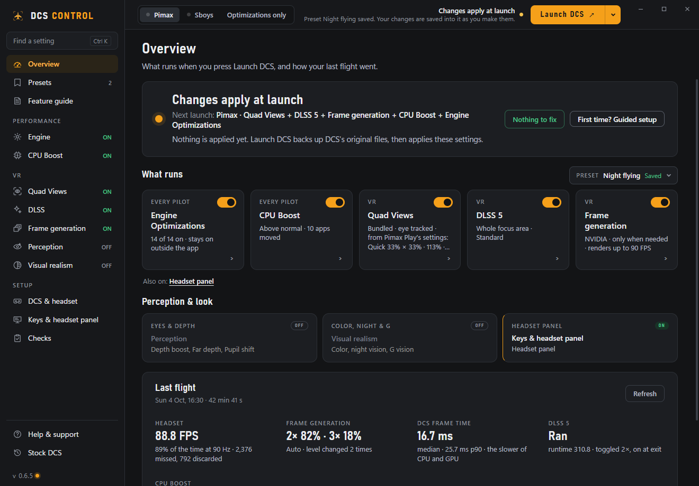

- **The status card** at the top says what the next launch runs and whether it is applied, with **Guided setup** next to it and, when Checks found something, a link to it.
- **What runs**: one card per feature, the optimizations first (Engine Optimizations, CPU Boost), then Quad Views, DLSS 5 and Frame generation. Switch it on or off, read its current settings at a glance, click the arrow to open its page. With Optimizations only, the VR features are hidden. The **Preset** button switches presets, or saves a new one, without leaving the page.
- **In the headset**: Perception, Visual realism and Keys & headset panel, with ON or OFF; click one to open its page.
- **Last flight**: below, after DCS has run (see the next section).
- When an update is out, a line at the top offers **What's new** and **Update** (see [Updates](#updates)).

#### Last flight

After DCS exits, the **Overview** shows a summary read from the logs of that session (see the screenshot at the top):

- **Headset** — average FPS delivered, share of time at the refresh rate, missed and discarded frames (Pimax runtime log).
- **Frame generation** — how often frames were generated: the share of time with none, 2× and 3×, and how many times the level changed. With Only when needed, "None" is the time DCS kept up on its own; when frames were generated most of the flight, the row adds DCS's GPU time per frame and the time it has to stay under for frames to pass through (set by Stop generating).
- **Frame rate held** — shown when the headset software (motion smoothing) held DCS at a fraction of the refresh rate for at least half the flight without frame generation, with CPU and GPU to spare: no optimization can raise it. Needs Engine Optimizations.
- **DCS frame time** — median and 90th percentile of DCS's CPU/GPU time per frame (with Auto 2×/3×).
- **DLSS 5** — whether it ran, runtime version, hotkey toggles.
- **CPU Boost** — apps moved and restored, anything that needed administrator rights.
- **Engine Optimizations** — whether they really ran: how many were on ("18 of 18 on"), any that turned themselves off for safety (amber), how long the in-flight key had them off ("Off in flight", grey, when that was most of the flight) and how long the shader warm-up took. On a GPU whose driver has no command lists (AMD, for example) it says the multi-threaded G-buffer and shadows could not run.
- **Terrain prefetch fix** (Engine Optimizations) — share of prefetch calls skipped.

Parts without a log are left out. VRAM is not logged; use the in-headset VRAM counter for that.

### Presets

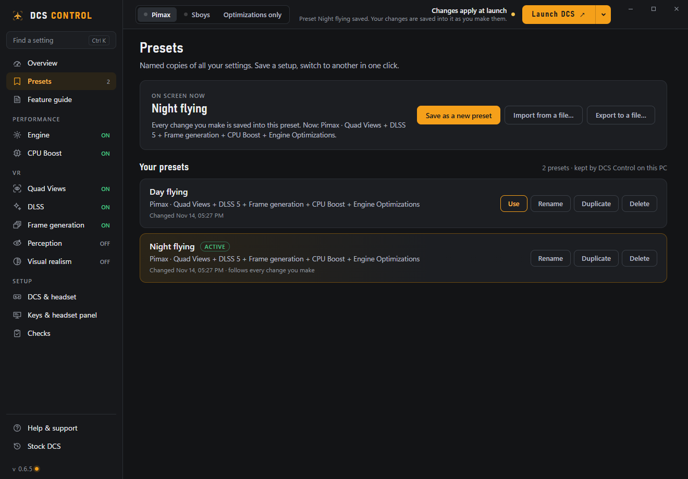

A preset is a named copy of all your settings: one for day flying, one for night, one for a heavy mission. They live on the **Presets** page.

- **Save as a new preset** — keeps the settings on screen under a name and makes that preset the active one.
- **The active preset follows you** — every change you make is saved into it as you make it.
- **Use** — switches to another preset. Launch DCS then applies it.
- **Rename**, **Duplicate**, **Delete** — on each preset's card, which also says what the preset runs and when it last changed. Delete asks for a second click; the settings on screen stay.
- **Import from a file… / Export to a file…** — to share settings or move them to another PC (before 0.6.5: Load… and Save as…).

The **Preset** button on the Overview switches presets, or saves a new one, without leaving the page.

### Feature guide

Not sure what to turn on? The **Feature guide** explains every feature in a few lines: what you get, what to expect, what it costs, what it needs and its in-flight key, and whether it is on in your profile. Its **Open** button takes you to the feature's settings.

### Engine Optimizations

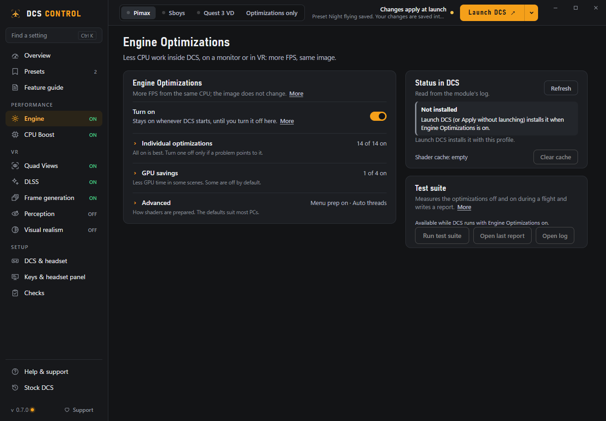

**Engine Optimizations** (**Engine** in the left rail) is off by default, and it is for every pilot, on a monitor or with any headset. **Turn on** switches it on. Once applied it stays on every time DCS starts, also from Steam or a desktop shortcut, until you turn it off or use Back to stock DCS. When on, Launch DCS installs a small module (DcsQvCull) that DCS loads itself through a Lua hook in `Saved Games\DCS\Scripts\Hooks`; nothing in the DCS install folder changes. It removes CPU work from DCS's render thread without changing what is drawn. The parts are in the **Individual optimizations** fold (it says how many are on; all on is best, turn one off only if a problem points to it), the GPU savings in their own fold below it, and **Advanced** last:

- **Streaming timer cache** (on) — DCS reads a high-resolution clock on every texture bind, tens of thousands of times a frame, only to timestamp texture-streaming use. The module serves it from a value refreshed every millisecond, far finer than streaming needs; nothing you see changes. Measured: **+5 to +6 % FPS**.
- **Culling partition boost** (on) — DCS splits the search for visible objects into 12 uneven tasks and waits for the slowest. The module splits the same work into 16; the same objects are found. Measured: **+2 % FPS**, p95 frame time −3 %.
- **Culling partition by real cost** (on) — the visible-object search is split into tasks by what each object actually costs to check, measured as DCS runs, so the tasks end together. Measured: **+2.75 % FPS**, p95 −4 %.
- **Frame memory per thread** (on) — short-lived per-frame memory comes from one shared heap the model threads queue for; each thread gets its own blocks. Measured: **+1.5 % FPS**, culling 9 % faster.
- **Task queue clock cache** (on, needs the streaming timer cache) — the frame-start drain of DCS's task queue reads the cached clock. It helps while the camera moves fast (render-thread drain 2.9 → 1.6 ms per frame in a fast flight) and changes nothing when static.
- **Shadow caster instancing** (on) — identical objects casting shadows are drawn with one instanced draw per shadow cascade. The module compiles instanced versions of DCS's own shadow shader in the background, about 2.5 minutes after DCS starts (nothing is written to the DCS install); until then shadows are drawn as before. Shadow draws also skip the textures those shaders never read, and the grouping is planned off the render thread. Verified texel-identical; it turns itself off on any fault. Measured: **+2.8 % FPS**, **+1.9 %** more from planning in the background, and 2–4.5 % shorter frames while the head moves (p95 30.0 → 25.7 ms in slow head motion).
- **Model data allocator** (on) — the threads that prepare aircraft and object models share one allocator and wait for each other; the module gives each thread its own blocks. Measured: **+6 % FPS**, p95 −9 %.
- **Texture streaming dedupe** (on) — repeated streaming requests for the same texture and size within a millisecond are skipped. Measured: **+2 % FPS**.
- **Effect constant-buffer skip** and **Statistics counter without lock** (on) — a constant buffer set again although it is already set is skipped, and a statistics-only triangle counter no longer makes the model threads wait on each other. Measured together: **+3.6 % FPS**.
- **Terrain prefetch fix** (Off / Skip repeats; Skip by default) — DCS's terrain workers ask Windows to prefetch the same memory ranges about a million times a second. The fix skips the repeats; a prefetch is only a hint to Windows, so the image cannot change. Since 0.7 a terrain thread that keeps hitting skips pauses for 1 ms now and then (never the render thread). Measured in 0.7's test flights against the fix's count-only mode: about **45 % less DCS CPU** and a render thread 6 to 11 % faster. Statistics every 10 s in `Saved Games\DCS\Scripts\DcsQvCull\DcsQvCullPrefetch.log`. Until 0.5.4 this was a CPU Boost option that put `dxgi.dll` and `dxgi2.dll` in DCS's `bin` folder; the next Launch DCS (or Apply) removes them and puts back your own `dxgi.dll` if you had one.
- **Multi-threaded G-buffer** (on) — DCS draws the scene's models into its G-buffer on the render thread, one at a time. The module records those draws on worker threads in DCS's exact order and DCS replays them; parts whose textures changed are recorded again. Verified pixel-identical live. Measured: **+22 to +24 % FPS** on its own. It uses about 12 more worker threads and turns itself off, with a warning on the page, if DCS's code is not what it expects.
- **Multi-threaded shadows** (on) — DCS draws the shadow cascades on its render thread, one object at a time. The module records those draws on 8 worker threads and DCS replays them; the nearest cascade but one stays as DCS draws it. Verified texel-identical live. Measured: **+3 to +5 % FPS**, p95 −4 to −7 %; total CPU use rises 4 to 7 % because the work moves to other cores, and it uses about 30 MB more memory. It turns itself off, with a warning on the page, if DCS's code is not what it expects.
- **Redundant state filter** (on) — DCS's renderer sets graphics state (shaders, buffers, textures, samplers) that is already set, about 228,000 times a frame on an airfield; the repeat is skipped where DCS makes the call. Verified identical live (362 frames, no mismatch). Measured: about **+0.5 to +1 % FPS** and **1.2 % less CPU**. It turns itself off after a DCS update until it is checked against the new build.
- **GPU savings** (folded; the fold says how many are on):
  - **Faster terrain and shader paths** (on) — GPU shortcuts in DCS's terrain and shader work that give the same image. Turn it off only if a problem points to it (it was added as a switch for GitHub #28). Switched on in flight, it reaches its full gain within a few minutes of flying.
  - **Cache distant shadows** (EXPERIMENTAL, off) — reuses the distant shadows (about 70 m to 1.5 km) for a few frames: about 0.7 ms less GPU time per frame. Distant tree shadows then sway a little less smoothly (they update about 11 times a second).
  - **Skip hidden water** (EXPERIMENTAL, off) — DCS skips its water work for an eye that sees no water, so there is less GPU time while no water is in view. When water comes into view it can appear a few frames late.
  - **Skip unused effects** (EXPERIMENTAL, off) — skips shading work on water that changes nothing, and the heat-haze passes when nothing is hot. The image is the same; the saving is small (about 0.2 ms over open sea, less for the heat haze).
- All together about **+50-60 % FPS** depending on the scene (+46.0 % ±1.1 and +49.9 % ±3.7 in two runs, 42 → 63 FPS), p95 −34 %, with the image verified identical pixel by pixel; with everything on, the GPU becomes the limit (96-97 % busy), measured with the module's automatic A/B test (the in-flight switch off and on, 24 alternating blocks) at a busy VR airfield (Ryzen 7 9800X3D, RTX 5090, Pimax Crystal Super, Quad Views, no frame generation); the rendered objects were identical off and on. How much you gain depends on how CPU-bound you are; when the GPU is the limit, little or nothing. Each optimization checks the DCS build first; after a DCS update it looks for the code it patches by signature and checks the bytes it expects, and stays off, with a warning on the page, if it does not find them.
- **In-flight switch** (Alt+Shift+F11 by default, AltGr+Shift+F11 works too; click the field and press any other combination, Backspace for Off) turns all the optimizations off and back on during a flight so you can compare: one beep off, two beeps on (**Beeps for the in-flight switch** turns the sounds off). Applying a profile starts with them on again.
- **GPU-bound guard** (always on) — when the graphics card, not the CPU, is the limit, the multi-threaded shadows and G-buffer cost a little GPU time for nothing. The module then steps them down (fewer shadow recorders, then no helper lists, then both paused) and back up when the CPU is the limit again. Each step is tried against the step before for 20 seconds each and kept only when it raises FPS by more than 2 %; a step that does not help is undone and not tried again for a while. It only switches between exact paths, so the image never changes. Every 10 seconds the module's log says whether the frame was CPU- or GPU-bound.
- **Shader warm-up and cache** — while DCS runs, **Status in DCS** shows "Shader warm-up: 120 of 200 ready" with a thin bar until the module has prepared the shaders it needs (see [the FAQ](#engine-opt-warming-up)); the line goes away when it is done. Below it, "Shader cache: N variants, X MB" with **Clear cache** (only while DCS is closed). Under **Advanced**: **Prepare shaders in the main menu** (on) gets shaders a DCS or app update made stale ready while you are still in the menu, and **Compile threads** (Auto, 2, 4 or 6) sets how many CPU threads prepare them. Both take effect at the next DCS start.
- **Multi-threading without driver support** (on by default): shown only on a PC whose graphics card lacks D3D11 command lists (AMD, for example); elsewhere it does nothing. See [the FAQ](#multi-threaded-shadows-and-g-buffer-are-unavailable).
- **For developers:** Turbo mode, the Alternative Quad Views provider, DLSS 5's Depth convention and Motion scale, the Observe choice of the terrain prefetch fix and the Engine page's Developer options (Developer mode, Measurement hooks, Streaming timer refresh) are hidden. They appear only with `"developerOptions": true` set by hand in the profile; without it a profile loads them at their safe values (Turbo off, the bundled Quad Views, the game's depth and motion, Observe as Off, Developer mode off).

**Status in DCS** reads the module's own log: whether DCS loaded it and whether each optimization found what it needs in this DCS version. After a DCS update the module checks itself; a part that does not recognise the new build turns itself off and the page shows a warning.

**Test suite:** in flight, with the headset on and awake (or on the monitor), press **Run test suite** (or Ctrl+Alt+F11 in DCS). It compares all the optimizations off (stock DCS) against on, in alternating 5-second blocks for about 3 minutes, and writes a report (**Open last report**): two beeps when it starts, three high beeps when it is done, one long low beep when it stops. Keep your head still in a busy scene; blocks while the headset sleeps are thrown away. On a headset without quad views it compares whole frames, and the report says so. If it stops at once saying no frames were counted, the module did not recognise the headset's views: please report it with a diagnostic package. The module's developer keys are off; Ctrl+Alt+F8 to F12 and Ctrl+Alt+Page Up/Down stay reserved for it.

Tested on DCS 2.9.30 and 2.9.31 in single player. Back to stock DCS (or turning the option off and launching) removes the hook, the module and everything it wrote.

### CPU Boost

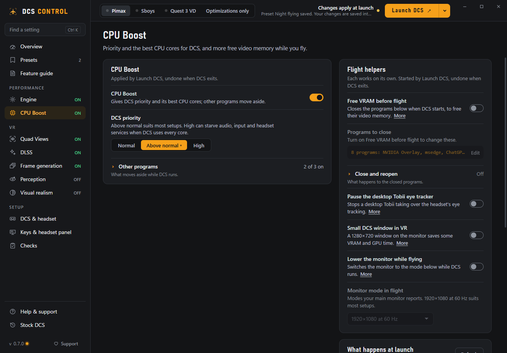

CPU Boost is off by default. When on, a small helper starts with DCS and **undoes everything when DCS exits**:

- **DCS priority** — Above normal (default), Normal or High (High can starve audio, input and headset services).
- **Other programs** (folded; it says how many are on):
  - **Move VR runtime and headset services** off the cores DCS uses for its main and render threads (Pimax route; on SteamVR the compositor is left alone).
  - **Move background apps** (your list, e.g. browsers, OneDrive) to the slowest cores at below-normal priority.
  - **Administrator rights** (see below).
- The core ranking comes from DCS's own CPU classification in `dcs.log`, so **DCS needs to have run once** on this PC. Without a ranking, only DCS's priority changes, and the page says so.
- **What happens at launch** (below the cards) shows the exact plan for your PC before you launch: which processes, which cores, what is running now, and what needs administrator rights. **Administrator rights** (optional) lets it move services that run under other accounts; DCS still starts as your user.

The terrain prefetch fix that used to be a CPU Boost option is now part of [Engine Optimizations](#engine-optimizations).

#### Flight helpers (VRAM)

Four more options on the CPU Boost page, all off by default and usable without CPU Boost:

- **Free VRAM before flight** — closes the programs in **Programs to close** when DCS starts so their video memory goes to DCS (default list: NVIDIA Overlay, Edge, ChatGPT, Hue Sync, Razer Cortex/Synapse, Wallpaper Engine; Discord and OBS are deliberately not listed). Programs get a normal close request; they are ended after 5 s only if you allow it (**End programs that do not close**). **Reopen after the flight** starts them again when DCS exits. Both are under **Close and reopen**. What happens at launch shows each program's VRAM now (approximate). Measured on the test PC: NVIDIA Overlay held about 1.4 GB.
- **Pause the desktop Tobii eye tracker** — for a Tobii Eye Tracker 5 or 4C next to a Pimax Crystal. Its software (Tobii Experience) also takes hold of the headset's Tobii eye tracker, and Pimax eye tracking (and so the moving focus area of Quad Views) stops working. With this on, the desktop tracker's services (Tobii Experience and the Eye Tracker 5/4C runtime) are stopped while DCS runs and started again when DCS exits; the headset's own eye-tracking services are never touched. It needs administrator rights, so Windows asks (UAC) when DCS starts. What happens at launch lists the services it would pause. If the helper was ended before DCS exited (a crash, Task Manager), Checks shows *Desktop Tobii eye tracker* with **Start Tobii** (one Windows prompt).
- **Small DCS window in VR** — sets the DCS desktop window to 1280×720 windowed (restored with the originals). The headset image is unchanged; the smaller desktop buffers save some VRAM and GPU time.
- **Lower the monitor while flying** — switches your main monitor to a smaller mode (1920×1080 at 60 Hz suggested) for the flight only; the previous mode comes back when DCS exits, even after a crash (at the next start). Windows never saves the flight mode. HDR is left alone.

### Quad Views

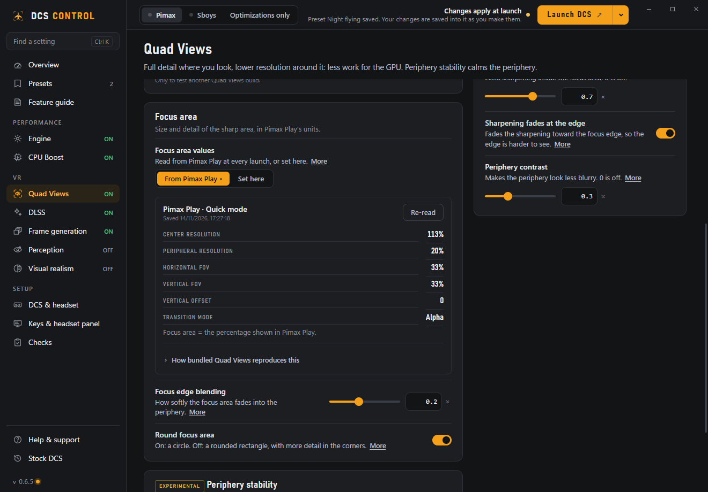

The app uses its **bundled Quad Views** (Quad-Views-Foveated). This is the one that works with DLSS 5 and frame generation. **Pimax native** Quad Views (Pimax route only) is also offered as the provider, but it cannot be combined with DLSS 5. Leave Quad Views **on** in Pimax Play (with eye tracking): that is the tested setup. The bundled Quad Views takes DCS's quad views over from Pimax's own, so DCS only ever sees the bundled one, and the app reads your Pimax Play Quad View values. Only the provider choice in the app matters: select Bundled, not Pimax native, for DLSS 5.

**Foveated rendering** card:

- **Quad Views provider** — *Bundled Quad Views* (recommended), *Pimax native Quad Views* (Pimax route only, not with DLSS 5) or *Off* (normal stereo).
- **Focus movement** — *Eye tracked* (needs working eye tracking in Pimax Play, or a gaze bridge on Sboys) or *Fixed (centred)*.
- **Eye-tracking options** (folded; the fold says how many are on, or *Eye tracked only* with a fixed focus). None of them costs GPU time: the focus keeps its pixel count and is only briefly less dense while the eyes move. The Quad Views log has a `DCSVR gaze` line every 30 s with the saccades seen and how often each option acted.
  - **Focus ahead of fast eye movements** (on) — with frame generation the focus area follows your eyes only on the frames DCS renders and reaches the headset 55–88 ms later, so after a quick glance your eye can land outside the sharp area for a frame or two. This makes the focus area reach ahead along a fast eye movement while it lasts, by about that latency (25 ms without frame generation, 40 ms with the option below, 55 ms in 2×, 85 ms in Auto and 3×).
  - **Stay ahead until your eyes land** (EXPERIMENTAL, on; needs the option above) — eyes slow down just before they land. The focus area stays ahead of them through that last part of the jump and is back to its normal size as soon as they have landed.
  - **Steady focus while looking** (on) — movements under half a degree are ignored, so eye-tracker noise does not make the focus edge shimmer. Real eye movements are followed at once.
  - **Slide back when tracking is lost** (EXPERIMENTAL, on) — when the eye tracker loses your eyes for more than a moment (a long blink, the headset shifting), the focus area slides to the centre and to the fixed focus size over 150 ms instead of jumping. When your eyes are found again it follows them at once.

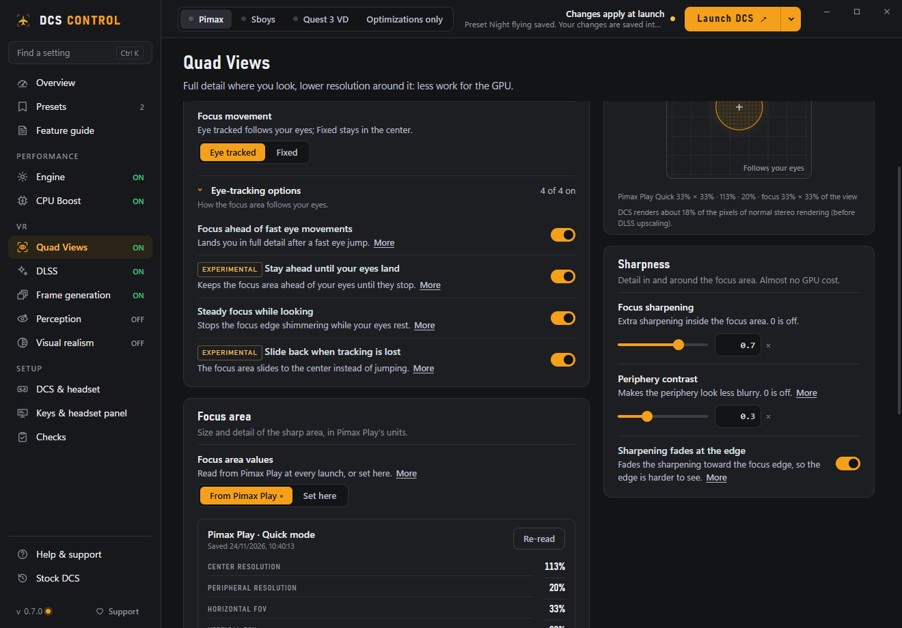

**Focus area** card:

- **Focus area values** — *From Pimax Play (recommended)* (default) or *Set here*.
  - With **From Pimax Play**, the app reads your Quad View values from Pimax Play every time you launch (on both routes; it never writes to Pimax). The page shows them **exactly as Pimax Play shows them**: same labels, same order, same rounding — for **Quick** mode: Center Resolution, Peripheral Resolution, Horizontal FOV, Vertical FOV, Vertical Offset, Transition Mode; for **Fine** mode: the "→ Center" sliders, Transition Range and Alpha.
  - The app follows whichever tab is active in Pimax Play. Clicking the *Fine* tab in Pimax Play switches Pimax to Fine mode, so the app reads the Fine values from then on. Go back to *Quick* in Pimax Play if that is the one you want.
  - If you change the values in Pimax Play, you don't need to do anything else: the next **Launch DCS** updates the focus area ("Pimax Play changed: focus updated to …").
  - With Pimax on **Custom**, the focus area is **exactly the percentage Pimax Play shows**: Horizontal FOV 25% gives a sharp area 25% of the view wide (in Fine mode, Left + Right → Center add up). The page states the resulting size ("Focus area: 25% × 25% of the view"). With **Pimax native** selected, the page shows the focus size Pimax's own runtime reports for these values, which is not the same number (in its log, 25 gives a focus 75% of the view). Whether a worn headset really shows that size is not settled yet.
  - With Pimax on a **preset** (Performance, Balanced, Quality, Extreme), bundled Quad Views renders the preset as Pimax's own Quad Views does, with the preset's center resolution (1.0×, 1.1×, 1.225×, 1.35×) and peripheral resolution (0.30× for Performance, 0.32× for the others). The focus area depends on **Focus movement**: eye tracked, 27% × 30% of the view (Performance), 31% × 32% (Balanced), 33% × 33% (Quality), 39% × 33% (Extreme); fixed, 46% × 45% for all four. The fixed size was measured on Pimax's own Quad Views; the eye-tracked ones are worked out from the values Pimax's runtime logs for each preset. With Quad View **Off** in Pimax there is nothing to follow and the profile's own values (Set here) are used. Center Resolution is the pixel density: 120% is 1.2×. This follows Pimax Play's 2026-10 scales; Pimax's own native Quad Views sizes its focus differently from the same sliders.
  - With **Set here**, you set the values in the app, in the same Quick units as Pimax Play.
  - **Vertical offset** (Set here only) moves the focus area below (negative) or above where you look, or below or above the centre with a fixed focus area. It is Pimax Play's Vertical Offset scale: -100 to 100, where 100 is a quarter of the view's height. In an aircraft, about -10 to -20 keeps the gauges sharp in your lower vision while you look outside. Keep it small: the Checks tell you when the point you look at would leave the fully sharp part of the focus area. The Coverage preview draws the shift; the cross is where you look. With **From Pimax Play** the bundled Quad Views uses no offset (Pimax Play's own Vertical Offset is shown, not applied), and Pimax native Quad Views takes it from Pimax Play.
- **Hide the focus edge** (on by default, applies in flight; with Soft focus edge on, at the next launch) — makes the short flash at the edge of the focus area much smaller when you look somewhere else. Off gives what Quad Views did before 0.7, and turns all its parts off. They are under **Fine-tune**, which says how many of those that can work here are on:
  - **Smooth small moves** (40 ms; eye tracked only) — the small corrections while you look at something are spread over a few frames. Eye jumps and moves over 2 degrees are never delayed. 0 is off.
  - **Soft focus edge** (EXPERIMENTAL, off by default; needs some edge blending) — in the edge band the focus area first loses detail down to the periphery's resolution, then fades out, so you see one image getting softer instead of a sharp one over a blurry one. The ring around where you look is harder to see; the finest detail near the edge is a little softer. It also works with foveated frame generation.
  - **Fade in** (2 frames; with foveated frame generation) — parts of the view the focus area newly covers fade in instead of popping in. 0 is off.
  - **Steady periphery through eye jumps** (on; with Periphery stability) — Periphery stability carries on when your eyes jump, instead of starting over.
  - **Match brightness at the edge** (1; with foveated frame generation) — evens out the brightness where the focus area meets the periphery, for a focus area that looks brighter or darker than around it, as DLSS 5 can make it. 0 is off. **Match color too** (off) evens out the color as well.
  - With DLSS 5, its **Local tone** setting matters most: 0 removes most of what is left of the flash, at the cost of some local contrast.
- **Shape and edge** (folded; it shows the shape and the edge in use):
  - **Focus edge blending** — how wide the focus area's edge fades into the periphery (wider is softer, a little less fully sharp area). With Pimax Play's values and its Transition Mode Off, the edge is hard (0).
  - **Round focus area** — on, a circle; off, a rounded rectangle with more detail in the corners. A central DLSS 5 area follows the same shape.
- **How bundled Quad Views reproduces this** (folded, under Pimax Play's values) shows the conversion and, once DCS has run, the focus size in pixels per eye.
- **Coverage preview**: the focus area to scale, and how many pixels DCS renders against normal stereo.
- **Sharpness** card: **Focus sharpening** (0.7; 0 is off), **Periphery contrast** (0.3; brings back some of the local contrast the periphery loses at its lower resolution; raise it slowly, too much makes the periphery shimmer) and **Sharpening fades at the edge** (on). Almost no GPU cost.

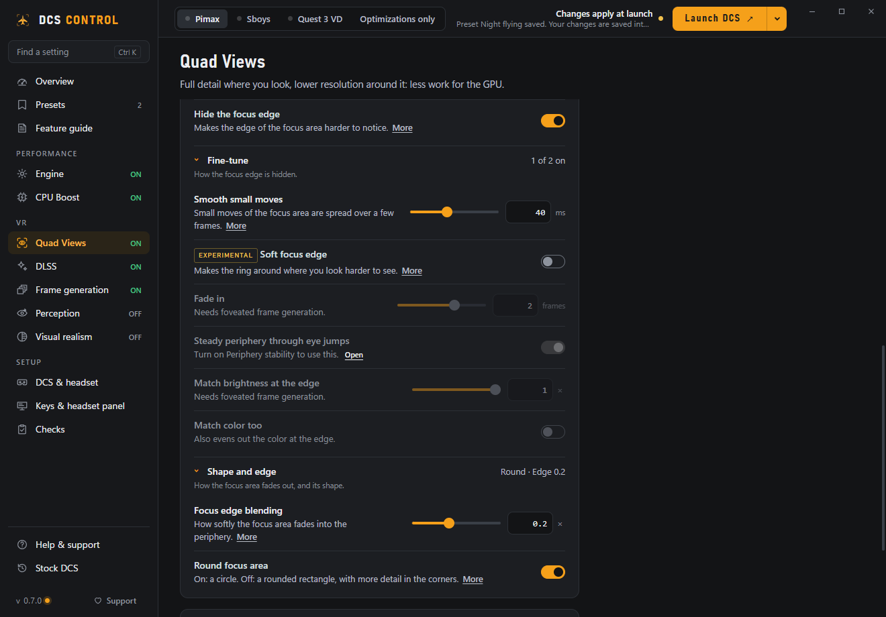

On the **Quest 3 VD** route Pimax Play is not read and the focus is fixed in the centre: Focus movement, Focus area values and the Eye-tracking options are hidden, and the focus area starts at Horizontal FOV 55%, Vertical FOV 75% (tall enough to keep the instruments sharp), Peripheral Resolution 40% and Center Resolution 100%, which you can change on the page. Switching back to Pimax or Sboys in the same app session gives you the focus values you had before; a profile that started on Quest 3 VD follows Pimax Play again.

**Cost/benefit, measured on the test PC (Crystal Super, RTX 5090):** with Pimax Play's own Quad View values, bundled Quad Views ran at about **78 FPS** with working eye tracking, against about 37 FPS with the much larger old defaults. At the same Pimax percentages, bundled Quad Views draws a smaller focus than Pimax's own runtime does. The bundled provider is limited to 90% of the view per axis.

#### Periphery stability (experimental)

Its own card on the **Quad Views** page (tagged EXPERIMENTAL). Outside the sharp focus area the enlarged periphery shimmers on thin lines (canopy frame, power lines, horizon), and there the eye is most sensitive to flicker. Periphery stability blends each periphery frame with the previous one, moved with your head, and leaves the focus area untouched. A jump of the eyes, a pause or a large head turn starts it over. Bundled Quad Views only, fixed or eye-tracked focus; about 0.03 ms of GPU time; off by default.

- **Strength** (0.5 by default): higher steadies more but can leave a faint trail on scenery that moves on its own, such as the ground while the aircraft rolls.
- With Pimax native Quad Views or without Quad Views it is not applied; the page and Checks say so. Details and measurements: [PERCEPTION.md](PERCEPTION.md).

### DLSS

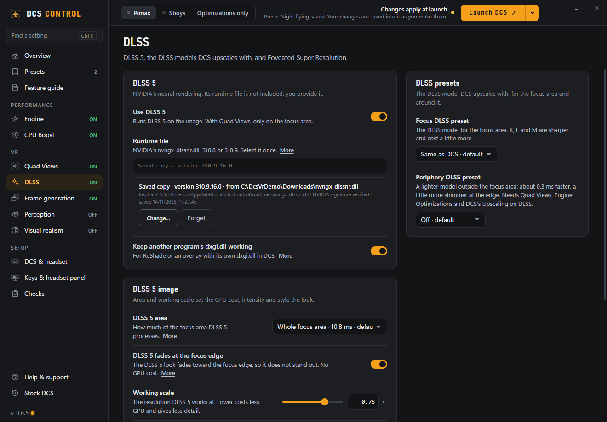

DLSS 5 runs NVIDIA's DLSS-NR neural model on the two Quad Views focus views. DCS's own DLSS keeps running as usual.

**The runtime file — bring your own.** DLSS 5 needs NVIDIA's `nvngx_dlssnr.dll`, **version 310.8 or 310.9**, x64, signed by NVIDIA Corporation (310.9 is NVIDIA's newer, faster model; 310.8 is the one tested most). It is not included in this app. NVIDIA does not offer this file for download on its own, and DCS Control cannot provide it or tell you where to get it. The app accepts only NVIDIA's signed file, or on RTX 20, 30 and 40 cards NVIDIA's file changed by a compatibility patch (below). Select it once with **Browse** (or let **Read settings from this PC** find it): the app checks it and keeps a **verified copy** in `%LOCALAPPDATA%\DcsControl\runtimes`, which every profile then uses. The page shows "Saved copy · version 310.8.0.0 · from …" with **Change…** and **Forget**. A file that fails the checks is refused and nothing is saved.

**RTX 20, 30 and 40 cards.** NVIDIA's runtime runs only on RTX 50 cards: on older cards DLSS 5 shows "ON but not applied". Community patches rewrite its GPU code for RTX 20, 30 and 40 cards, which breaks NVIDIA's signature. When you select such a file with **Browse**, DCS Control accepts it if it is still NVIDIA's x64 runtime, version 310.8 or 310.9, with no signature or NVIDIA's own (now invalid) one, and the saved copy says "NVIDIA's file changed by a compatibility patch". A file validly signed by anyone else is refused, and **Read settings from this PC** only ever picks files with a valid NVIDIA signature. The patched file is not NVIDIA's release: use it at your own risk, and expect a larger GPU cost than on RTX 50 cards. On an RTX 50 card the patch is not needed: use NVIDIA's original file.

Settings:

- **Working scale** — lower = less GPU work and less neural detail.
- **DLSS 5 area** — the whole focus area (default) or its central 90%, 80%, 70% or 50% (round when *Round focus area* is on), faded into the normal image at the edge. Measured GPU time for both eyes on an RTX 5090 at 1764×2480 per eye (in 0.4): **10.75 ms** whole area, about 9.3 ms at 90% (estimated), **7.9 ms** at 80%, **6.35 ms** at 70%, **4.8 ms** at 50%.
- With DLSS 5 on, Checks also reminds you to add `HUD_MFD_after_DLSS = true` to `Saved Games\DCS\Config\autoexec.cfg`, so the HUD and MFDs stay sharp; DCS Control never edits that file. If DLSS 5 fails 30 times in a row it stops for the rest of the session.
- **Intensity** (default 1 = full model output) and **Model style** (Standard, Natural, Cinematic) change the look, not the cost.
- **Advanced** (folded; it says *Defaults* until you change one) — **DLSS 5 fades at the focus edge** (tone, color and detail fade out toward the edge of the focus area, so DLSS 5 does not stand out there) and **Process at render resolution** (on: before DLSS upscaling, faster and subtler; off: at output resolution, more detail and more GPU).
- **In-flight key** (Keys & headset panel page) turns DLSS 5 off and on in flight to compare (default **Ctrl+Shift+F12**).
- **Keep another program's dxgi.dll working** (on): see [ReShade with DLSS 5](#reshade-or-another-dxgidll-mod-with-dlss-5).
- **Advanced image controls** (folded, at the bottom of the page) — model corrections in two groups, *Structure & appearance* (local tone, local structure, skin structure, automatic mask, UI correction) and *Color & transfer* (color strength, transfer strength, paper white scale, Match brightness), all at their defaults; change one only to fix something specific you can see. **Reset to defaults** puts them back. **Match brightness** (off by default, new in 0.7) keeps the DLSS 5 area as bright as the view around it, if you see a slightly darker disc where you look; it makes the disc much fainter, though DLSS 5's softer cloud detail can still show.
- **Foveated Super Resolution** (Cheeky) is a separate switch on the same page, for **stereo without Quad Views** only: a performance option that runs DLSS at full quality only where you look and lighter in the periphery. With Quad Views it is hidden and stays off: Quad Views already renders the periphery at lower resolution, and DLSS 5 builds on DCS's own DLSS of the focus views (with Foveated Super Resolution on, Cheeky would redo that upscale privately instead).

The **DLSS presets** card sets the DLSS model DCS upscales with, for the focus area and around it:

- **Focus DLSS preset** — *Same as DCS* (default), or the DLSS model for the sharp focus area (E, K, L or M); the rest keeps DCS's preset. K, L and M are newer and sharper, and cost a little more.
- **Periphery DLSS preset** — off by default. A lighter DLSS model (E recommended) outside the Quad Views focus area: about 0.3 ms faster per frame, with a little more shimmer at the edge of view on head turns. The focus area uses M, or your Focus DLSS preset. The choices are E (recommended) and F; a profile saved with K or M (offered until 0.7, heavier than E) uses E. It works with or without DLSS 5, needs bundled Quad Views, Engine Optimizations and DCS's Upscaling set to DLSS, and takes effect the next time DCS starts from Launch DCS. NVIDIA settings are not changed: it works even when the NVIDIA App forces a preset for DCS, because the preset is changed inside DCS only. Checks tells you when the NVIDIA App forces one.
- **In flight**, another letter for either preset is used from the next mission start (DCS sets up its DLSS once per mission). Turning a preset on or off waits for the next launch.
- **With DLSS 5 or Foveated Super Resolution**, Cheeky hooks DCS's DLSS before the engine module does. Since 0.7 the module chains its own hook behind Cheeky's, so both presets also work then (before, they could stay at DCS's preset). Cheeky also no longer starts in the helper processes of DCS's built-in browser, which load the same `dxgi.dll`.

### Frame generation

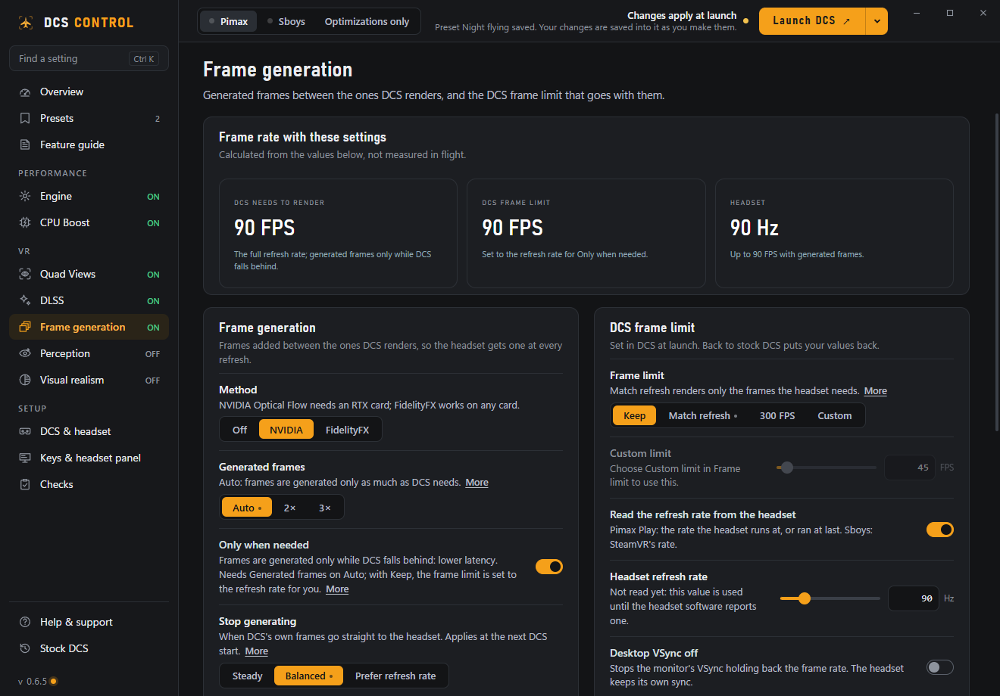

OFXR generates frames between the frames DCS renders. The top of the page shows what DCS needs to render for your headset refresh rate (90 FPS for 90 Hz with Only when needed, 45 FPS with 2×).

- **Method** — *Off*, *NVIDIA Optical Flow* (needs an RTX card) or *FidelityFX Optical Flow* (for cards without RTX; less tested).
- **Generated frames**
  - **2×** — DCS renders half the refresh rate (45 FPS at 90 Hz).
  - **3×** — DCS renders a third (30 FPS at 90 Hz): more headroom, but **more latency and more artifacts in sideways motion**.
  - **Auto** (default) — frames are generated only as much as DCS needs: 2× while DCS can hold half the refresh rate with margin, 3× when it falls behind, and 2× again later (none at all while DCS keeps up, with Only when needed). The diagnostic panel shows "2x auto" / "3x auto".
- **Only when needed** (on by default, with Auto only) — DCS renders at the headset's refresh rate, and frames are generated only when it falls behind. While DCS keeps up, its frames go straight to the headset (1×, about 45 ms less latency); when it can't, Auto 2×/3× takes over, and it goes back to 1× once there is headroom. Every flight and every new mission starts at 2× (DCS at half the refresh rate) and switches after about 5 seconds in which DCS looks able to hold the refresh rate and no frame came late; **Stop generating** below sets how sure it has to be. While frames are generated the module's log reads "capped at 45 fps (90 Hz / 2)": that is frame generation's own pacing, not a frame limit. The last flight summary shows the measured time next to the limit. It needs DCS's frame limit at the refresh rate (90 FPS at 90 Hz), so with **Keep** or **Match refresh** DCS Control sets it for you. A **Custom** limit below the refresh rate means DCS never keeps up and frames are always generated; Checks tells you. Off, or with 2× or 3× chosen, frames are always generated.
- **Foveated frame generation** (EXPERIMENTAL, off by default) — frames are generated for the focus area and for the rest of the view separately, instead of for the whole image: on the test PC, 3.9 instead of 9.75 ms of GPU time per generated frame and about 3 GB less video memory in use (one flight each, 24 November 2026). It needs the bundled Quad Views, the Pimax or Quest 3 VD route and NVIDIA frame generation; without them the switch is greyed out, and Checks says when it is on but cannot run. It gets ready on the loading screen, which pauses once for half a second. It helps most with a small focus area; with a very large one it can cost more than it saves. Smooth mouse cursor and Soft focus edge work with it. On the Quest 3 VD route it is new and has had less testing, so feedback is welcome.
  The focus area's soft edge is drawn into the focus image itself, and the focus area and the rest of the view are joined into one image before the headset gets it (about 0.14 ms of GPU per frame, from the flight logs). That is what removes the line and the flickering rectangle or spot that some Pimax setups showed at the edge of the focus area. There is nothing to set; a profile from an earlier 0.7 test build with a Focus layer choice loads as usual.
- **Advanced** (folded; it says *Defaults* until you change one) holds Stop generating, Smoothness buffer and Both eyes at once.
- **Stop generating** (with Only when needed; applies at the next DCS start) — when DCS's own frames go straight to the headset. The frame time at the full refresh rate is estimated while DCS runs at half of it, and that estimate reads high (a GPU at 50% at half the rate is about 100% at the full rate), so the choice is how far to trust it:
  - **Steady** — only with plenty of room: the estimate under 80% of one refresh (8.9 ms at 90 Hz), and generating again above 95%. The rule of 0.6.0 to 0.6.3. A PC that just holds the refresh rate with frame generation off rarely gets there, so frames stay generated.
  - **Balanced** (default) — tries when the estimate is within 110% of one refresh (12.2 ms at 90 Hz) and keeps DCS's own frames while they arrive on time; a single hiccup stays, and it generates again after 3 late moments in a second or 5 in ten seconds.
  - **Prefer refresh rate** — tries whenever it might hold (up to 125%, 13.9 ms at 90 Hz) and generates again after 3 late moments in a second or 10 in ten seconds. Lowest latency, with an occasional repeated frame when DCS is right at the limit.

  A try that fails is not repeated for 30 seconds, then 1, 2 and 4 minutes, so it cannot flip back and forth; after 3 failed tries in a row (6 with Prefer refresh rate) frames stay generated until the next mission, or until DCS has run three minutes without a late frame. On a scene that only just holds the refresh rate with frame generation off (GPU above about 90%), passing through does not last yet: in flown tests it held 90 FPS for seconds to under a minute, then DCS fell behind after a slow frame and frames were generated again. Balanced and Prefer refresh rate help between that and Steady's 80%.
- **Smoothness buffer** (on by default) — holds one extra frame to even out uneven DCS frame times: smoother, but about one refresh more latency (about 11 ms at 90 Hz) while frames are generated. In 3× it holds it only while frames keep arriving late; while Only when needed generates no frames, it adds nothing. Off = lower latency, more stutter when frame times jump.
- **Both eyes at once** (EXPERIMENTAL, off by default) — each eye's generated frame is made on its own GPU queue instead of one after the other, so generated frames are ready about 1 ms sooner. The image is the same. It has had less testing than the rest.

The **DCS frame limit** card sets DCS's own limit at launch; Back to stock DCS puts your values back:

- **Frame limit** — keep your current DCS limit (default), match the refresh rate, 300 FPS, or a custom value. Match refresh (recommended): DCS renders only the frames the headset needs: the full refresh rate, or half or a third with 2× or 3×. Written to `options.lua` and restored with the originals. Keep leaves your own limit, except with Only when needed, which sets the refresh rate (DCS's own limit is backed up and comes back with Back to stock DCS).
- **Desktop VSync off** — stops VSync of the desktop DCS window from holding the frame rate back. Headset sync is unaffected.
- **Use the headset's refresh rate** (on) — Pimax Play: the rate the headset runs at, or ran at last; Sboys: SteamVR's rate. Otherwise **Headset refresh rate** (90 Hz until the headset software reports one) is used.

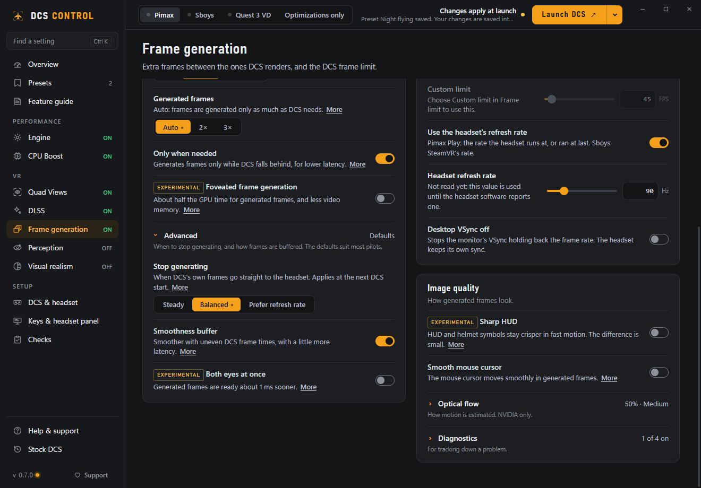

The **Image quality** card holds how generated frames look:

- **Sharp HUD** (EXPERIMENTAL, off by default; needs frame generation, not Depth boost or Engine Optimizations) — DCS draws the HUD and helmet symbols into the image, so generated frames blend two positions of them and they smear. On: the engine module hands the symbols over separately, frame generation makes the in-between frame from the world alone and puts the symbols of the nearest real frame back. DCS itself moves HUD symbols 20 times a second, so they keep that rhythm instead of smearing. Measured gain is small (by day the sharpest symbols lose about 2 % instead of 5–6 % in the worst moments); it costs about 0.15 ms of GPU time and 160 MB of video memory.
- **Smooth mouse cursor** (off by default) — DCS's mouse cursor is a small picture that frame generation cannot follow, so in generated frames it fades between where it was and where it is. On: generated frames find the cursor in the two real frames and draw it at its in-between position, so it moves at the headset's rate. Only the generated frames change; where you click doesn't change. When anything else could be the cursor (a look-alike symbol right next to it, or too much moving to search), that frame is left exactly as without the option. It works only while the mouse has moved in the last few seconds and costs about 0.05 ms of GPU time per real frame then (RTX 5090), nothing otherwise. See [Frame pacing](FRAME_PACING.md#smooth-mouse-cursor) for how to check it in a flight.
- **Latency trade-off, measured on an earlier build:** about 55 ms in 2× and about 88 ms in 3× from the start of a DCS frame to its display. If 3× feels laggy, see the [FAQ](#framegen-3-feels-laggy).
- **DCS's cockpit outline, depth and motion**: generated frames also use them, so the cockpit stays still and moving scenery shows fewer artifacts. This costs no FPS. The engine module hands them over; since 0.7 it is installed for this with frame generation in VR also when Engine Optimizations are off (in its Perception-only mode: none of the optimizations run).
- **VectorXR** (if installed) is turned off when DCS Control starts DCS for VR, so its frame generation and Quad Views don't stack on the profile's own. Your other games keep it.
- **Fine-tune** (EXPERIMENTAL, folded; NVIDIA only, all off by default; feedback welcome) — ways to clean up generated frames, each in one plain line on the page. They give cleaner edges around your aircraft in the external view (F2): **Clean edges against the sky** (no faint copy trailing an aircraft over the sky), **Keep the HUD steady over the sky** (no smeared HUD or dark aircraft over the night sky), **Sharper moving edges** and **Cleaner world beside the cockpit**. In test flights circling the aircraft in the external view they took away about a third of the halo around it at dusk and a quarter on its leading edge by day; in the cockpit view they change little, and by day they can move the faint trailing copy of a crossing aircraft ahead of it. Their GPU cost in those flights was a few microseconds per frame (offline at 5424 px per eye, at most about 0.1 ms per frame pair at 2X and 0.7 ms at 3X). All of them change in flight.
- **Optical flow** (folded; NVIDIA only) — **Optical flow resolution**, **Optical flow quality** and **Bidirectional flow**: higher costs more GPU. With foveated frame generation the resolution sets the focus area's; the rest of the view always uses its own full resolution.
- **Diagnostics** (folded) — **FPS counter**, **Frame generation log**, **Per-frame records** (the log can grow to 1 GB) and **Prepare in the background** (gets ready on another thread when a new view starts, for example when you leave the F10 map). Keep the defaults unless you are tracking down a problem.
- **Before you fly:** turn off other limiters and smoothing that fight frame generation — NVIDIA *Max Frame Rate* / *Background Application Max Frame Rate*, RTSS, Pimax Smart Smoothing, SteamVR motion smoothing. The app does not change these; Checks reminds you.

### Perception

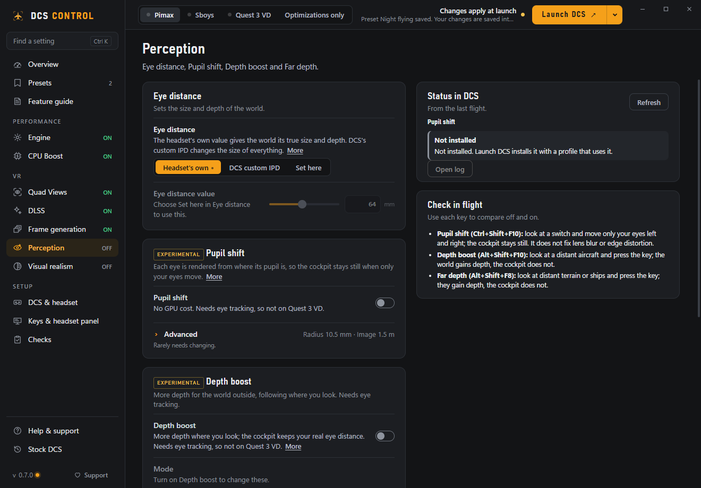

How deep and steady the world looks: **Eye distance**, then **Pupil shift**, **Depth boost** and **Far depth** (experimental, all off by default), then **Status in DCS** (read from the last flight) and **Check in flight** (each feature's key, to compare off and on). Pupil shift and Depth boost need eye tracking, so they are off on the Quest 3 VD route; Far depth needs the bundled Quad Views. Periphery stability is on the [Quad Views](#periphery-stability-experimental) page.

#### Eye distance

DCS renders with the eye distance your headset measured or was set to (Pimax Play or SteamVR): the world then has its true size and depth. If DCS's own *custom IPD* is on (often set to 64 mm because it was said to look better), Launch DCS turns it off while the profile is applied and Back to stock DCS turns it on again. To keep DCS's value choose **DCS's custom IPD** under **Eye distance** on the Perception page, or **Set here** for a value of your own (50-80 mm). Pupil shift and Depth boost use the same eye distance.

#### Pupil shift (experimental)

When your eyes turn, each pupil moves a few millimetres, but DCS renders both eyes from fixed points, so near objects shift slightly against far ones as you look around. With eye-tracked Quad Views (or, new in 0.7 and not flown yet, on Pimax with a fixed focus area or no Quad Views, from the headset's eye tracking), Pupil shift renders each eye from where its pupil is, then gives the headset its own poses back so the image is placed exactly as before. No GPU cost; off by default. It is the **Pupil shift** card on the **Perception** page (tagged EXPERIMENTAL). It needs eye tracking, so it is off on the Quest 3 VD route, and so is Depth boost.

- **Eye rotation radius** (about 10-11 mm) and **Lens image distance** (1-2 m), under **Advanced** — the defaults suit most people.
- **In-flight switch** (default Ctrl+Shift+F10) — turns it off and on to compare: a low beep off, a high beep on.
- **DCS's custom IPD**: if you set one in DCS, Pupil shift applies the same value itself and DCS's own option is off while the profile is applied, because DCS would otherwise undo the pupil's sideways move. Back to stock DCS turns it on again.
- The page shows the status from the layer's log (gaze range during the flight, largest shift, the headset views' cant and the eye distances) and what it corrects and what not. Details: [PUPIL_SHIFT.md](PUPIL_SHIFT.md).

#### Depth boost (experimental)

More depth for the world outside, following where you look. The world is rendered with the eyes a little further apart, changing slowly, while the cockpit keeps your real eye distance; cockpit displays, lighting and the HUD are unchanged. It needs eye tracking (not on the Quest 3 VD route). Off by default; turn it off for landings.

- **Mode**: *Realistic* (default, recommended) adds depth beyond about 150 m, only where the headset shows less than your eyes would. *Enhanced* adds more, from 3 m on; it is not realistic: the world looks smaller.
- **Strength**: Realistic ×1.25 by default (an eye distance of 64 mm becomes 80 mm far away); Enhanced ×1.4 (64 mm becomes 90 mm from 50 m on).
- **Advanced** (folded): **Normal depth up to** (150 m), **Full strength from** (400 m), **Cockpit distance** (1.5 m) and **Own aircraft at true depth** (on; helicopters and two-seaters: the other crew station stays at its real distance).
- **In-flight switch** (default Alt+Shift+F10): a low beep off, a high beep on. Its settings apply in flight.

Details: [PERCEPTION.md](PERCEPTION.md#depth-boost).

#### Far depth (experimental)

On the **Perception** page. It adds depth to distant scenery (about 50 m to 2 km): aircraft, ships and terrain stand out more, and the cockpit is not touched. It needs the bundled Quad Views, but no eye tracking; the engine module measures the depth DCS draws (with Engine Optimizations off it is installed for this alone, in its Perception-only mode). **Strength**: Subtle, Default or Strong; the strength and the in-flight key (Alt+Shift+F8) can be changed while DCS runs, turning it on or off waits for the next launch. The OSD shows "Far depth: ON", or "waiting for engine" until the depth arrives.

### Visual realism

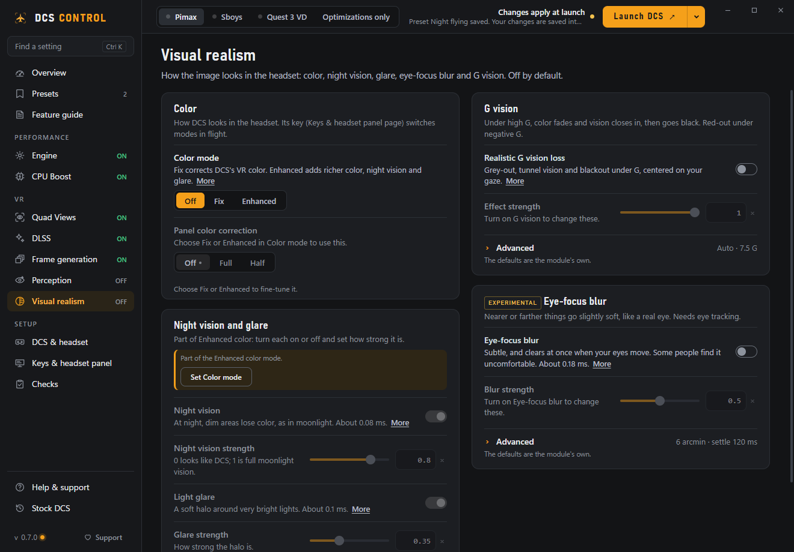

How the image looks in the headset, on its own page. Everything is **off by default**. Changes apply with Launch DCS; the **Color mode** key switches color modes in flight. VR flights only. The effects run inside the engine module: with Engine Optimizations off, turning one on installs the module in its Perception-only mode (none of the optimizations run). Times are GPU time per frame. None of these has been judged in the headset yet: try one at a time.

- **Color mode** — *Off*: DCS's own image. *Fix* (0.05 ms): corrects DCS's VR color faults (greyish blacks, a brightness step in the left eye) and adds a fine dither, so nights have black blacks and much less banding in dark skies; otherwise it looks like DCS. *Enhanced* (about 0.1 ms, plus night vision and glare, both on by default): Fix plus richer, filmic color, golden-hour warmth and eyes that adapt to light and dark. Each mode has its own brightness, night brightness, saturation, warmth and adaptation under *Fine-tune Fix* and *Fine-tune Enhanced*. The **Color mode** key on the Keys & headset panel page (off by default; Alt+Shift+F9 is a good choice) cycles Off, Fix and Enhanced in flight with 1, 2 or 3 beeps.
- **Panel color correction** (off by default; needs Fix or Enhanced) — for the Crystal Super: its wide-gamut panels (about DCI-P3) make DCS's sRGB colors look over-saturated, and Pimax does not convert them. *Full* corrects this, *Half* corrects half. HUD and MFDs are not affected. Don't combine it with Pimax's own color correction.
- **Night vision** (Enhanced only, about 0.08 ms at night, nothing by day) — at night dim areas lose color and turn slightly blue-grey, as your eyes do in moonlight; lights, lit instruments and the HUD keep their color.
- **Light glare** (Enhanced only, about 0.1 ms) — a soft halo around very bright lights: the sun, landing lights, strobes, fires, afterburners. The HUD never glares.
- **Eye-focus blur** (EXPERIMENTAL, about 0.18 ms) — things nearer or farther than where you look go slightly soft, like a real eye, and turn sharp the moment your eyes move. It needs eye tracking: eye-tracked Quad Views, or on Pimax also a fixed focus area or no Quad Views (new in 0.7, not flown yet). The pupil shift layer passes your gaze to the engine module, also without Pupil shift or Depth boost; without eye tracking the switch is greyed out and Checks says why, and on the Quest 3 VD route it is hidden. It runs only in flight, not in DCS's main menu. Some people find it uncomfortable. With frame generation the blur's release can show as a brief soft cross-fade in a generated frame.
- **G vision** (about 0.04 ms, only while G is high) — grey-out, tunnel vision and blackout under G, centered on where you look (straight ahead without eye tracking), and red-out below about −2 G when G vision does all of it (*Full*, or *Auto* with DCS's G effect off). It works with DCS's own G-EFFECT option without doubling it (*Mode* under Advanced). With frame generation the tunnel's edge can smear slightly during fast turns. In multiplayer the server must allow the aircraft data export it reads.

### Audio

**3D headphone audio** (experimental, off by default) uses a head-related transfer function (HRTF) to place DCS's mono positional sounds around you in stereo headphones. Aircraft and switches can sound above, behind or beside you. As you turn your head, sounds stay anchored to their sources. DCS still supplies distance, Doppler and canopy attenuation, and radio and intercom keep their original mix.

Use stereo headphones in VR or on a monitor. On a monitor, head tracking lets you hear the sound field respond to physical head turns. Select **Audio → Turn on**, then use **Launch DCS**. The app loads the audio module even when Engine Optimizations are off. The effect uses CPU time on DCS's audio thread.

- **Turn on** — the switch. Its key on the Keys & headset panel page (default **Alt+Shift+F6**) switches it off and on in flight, so you can compare with DCS's own sound; so does **Switch 3D audio off** (or **on**) in the Status card.
- **Head size** — the distance around your head, in cm: put a tape measure (or a piece of string) around your head just above the eyebrows and ears. **Small · 54 cm**, **Medium · 57 cm** (the average, and the default) and **Large · 60 cm** set it in one click. It sets how far apart your ears sound, so left and right are placed right for you. With your own SOFA set, leave it at 57 cm: your set already has your own head's timing.
- **Ears (HRTF)** — how your head and ears change a sound from each direction. **Generic (KU100)** is selected out of the box and suits most people: a measured dummy head (Neumann KU100, from the SADIE II database of the University of York). If you have your own measurement as a **SOFA** file (from an ear scan or a lab measurement), **Import SOFA…** converts it once and selects it. The app shows what it found (directions, sample rate, how much of the sphere is covered, how far apart in time a sound reaches the two ears) and warns about anything unusual; a file it cannot use is refused and nothing changes. If you already have a set with that name, it asks for another. **Remove** deletes the selected set. The SOFA file itself is never copied or sent anywhere: only the converted set, kept in DCS Control's own folder, goes to DCS when you launch.
- **Follow the head between frames** (on) — sounds stay in place when you turn your head fast: the headset's head position is read at audio rate, between DCS frames, from the pupil shift layer, which Launch DCS installs for it. VR only.
- **Cockpit space** (experimental) adds close reflections and a short decay to help cockpit sounds feel like they come from the space around you. **Subtle** is the default when 3D audio is on. Use **Off**, **Normal** or **Strong** to compare. The effect fades in external views and softens when the canopy is open if **Open canopy opens the space** is enabled. **Cockpit type** automatically selects an acoustic profile for the aircraft and can be overridden under **Advanced**.
- **Advanced** (folded): **Close sounds per ear** (on; switches and voices in the cockpit sound close, each ear on its own), **Cockpit type** (Automatic; picks the cockpit from the aircraft you fly: bubble canopy, framed canopy, helicopter cabin, warbird, transport flight deck, or generic for an aircraft it does not know; choose one here to use it in every aircraft), **Open canopy opens the space** (on; with the canopy open there is less echo), **Most 3D sounds** (48; the loudest sounds at once in 3D, the rest keep DCS's panning), **3D sound level** (0 dB; 3D sounds louder or softer against the rest) and **CPU budget** (25%; how much of each sound block it may use before it renders fewer sounds in 3D; Cockpit space first leaves out its close reflections, then 3D audio renders fewer sounds).
- **Diagnostics** (folded): **Sound log** (off) writes every 3D sound to a file next to the engine module's log, for a report.

**Status in DCS** shows what the engine module's log says: *Running* with the number of sounds in 3D and the CPU time per sound block, *Switched off* (with its key), or *Off* with the reason. With Cockpit space on it also shows its level and the cockpit in use, for example *In the cockpit: F-16C_50, bubble canopy.* On anything it does not expect (a DCS update that changed the sound engine, a speaker layout that is not stereo) it stays off and DCS's own sound plays: Checks and the Overview's Last flight say so. While 3D audio is on, Launch DCS sets DCS's **Speaker layout** to **Stereo** (Back to stock DCS, or turning 3D audio off, puts yours back). Windows spatial sound for DCS (Windows Sonic, Dolby Atmos through `sound.driver_name = "spatial"`) is the other way to get 3D sound: use one or the other. Every setting here applies live while DCS runs; turning it on in VR (with Follow the head) or while DCS's speaker layout is not Stereo yet, or picking a set imported after the launch, waits for the next launch. Without any HRTF set (a DCS Control build without the generic one, and none of your own) the switch is greyed out and says why.

### DCS & headset

At the top: **Read settings from this PC** and **Guided setup** (see [First run](#first-run)).

- **DCS**: **DCS executable** (`DCS.exe` in your installation's `bin` folder) and **DCS settings file** (`options.lua` in `Saved Games\DCS\Config`), found automatically; change them only if DCS is somewhere else or you have more than one install. **Show the DCS launcher** (off by default) opens DCS's own launcher first (see [The DCS launcher option](#the-dcs-launcher-option)).
- **Headset software**: the VR software of the route you chose (Pimax Play, SteamVR for Sboys, or Virtual Desktop for Quest 3 VD) and what runs now. On the Sboys route it also holds the **Sboys driver**: **Download / verify** (the official 1.3.0 release, checked before it is unpacked), **Import ZIP** and **Open Sboys tool** (install the driver from its About page; more in [SETUP.md](SETUP.md#sboys--steamvr-route)). **Runtime override** (folded) is only for an OpenXR runtime that is not registered in Windows; normally leave it empty.

### Keys & headset panel

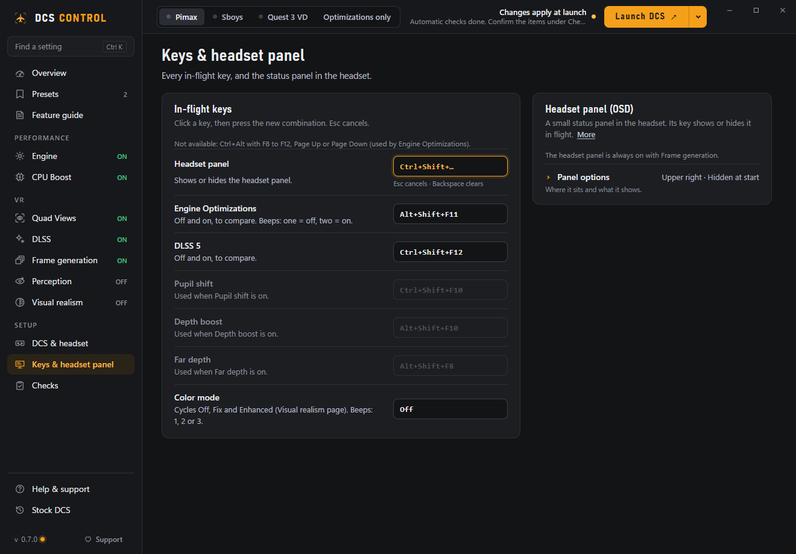

Two cards: **In-flight keys** and **Headset panel (OSD)**.

**In-flight keys** lists every key. A key whose feature is off in the profile is greyed out; with Optimizations only, only the Engine Optimizations key is shown.

| Key (default) | What it does |
| --- | --- |
| **Alt+Shift+F12** | Show/hide the headset panel (OSD) |
| **Alt+Shift+F11** | Engine Optimizations off/on (one beep off, two on); AltGr+Shift+F11 works too |
| **Ctrl+Shift+F12** | DLSS 5 off/on, to compare |
| **Ctrl+Shift+F10** | Pupil shift off/on (low beep off, high beep on) |
| **Alt+Shift+F8** | Far depth off/on, to compare (one low beep off, two high beeps on) |
| **Alt+Shift+F10** | Depth boost off/on (low beep off, high beep on) |
| *(off)* | Color mode: Off, Fix, Enhanced in turn (1, 2 or 3 beeps); Alt+Shift+F9 is free |
| **Alt+Shift+F6** | 3D headphone audio off/on, to compare with DCS's own sound (also on a monitor) |
| **Ctrl+Alt+F11** | Start or stop the Engine Optimizations test suite (fixed) |

To change a key, click the field and press the combination you want. Esc cancels, Backspace clears it. **Default** (shown when a key differs from its default) puts the default back. Keys need Ctrl, Alt or Shift unless they are F-keys, Pause, Insert, Home, End and similar. Windows' own shortcuts, the Windows key, another in-flight key's combination and the engine module's reserved keys (Ctrl+Alt+F8 to F12, Ctrl+Alt+Page Up/Down) are refused; a combination DCS binds by default is accepted with a note (and listed under Check yourself).

**Headset panel (OSD)**: a small status panel drawn in the headset; its key (default Alt+Shift+F12) shows or hides it in flight. With frame generation it is always on; without it, turn on **Headset panel**: OFXR is then loaded only to draw the panel and leaves your frames untouched. **Panel options** (folded): **Visible at start** (off), **VRAM counter** (off; the video memory in use, for when you suspect VRAM is full) and **Position** (the corner of your view, upper right by default). The **FPS counter** and the **Frame generation log** are on the Frame generation page, in the Image quality card's *Diagnostics* fold.

The panel shows FPS, DLSS 5 state (on with GPU ms, off, or why it is not applied), the frame-generation backend and mode (2×, 3×, auto), and DCS (app) vs headset (output) FPS. With the engine optimizations on, an **Engine** line says whether all of them are working (green "all N on"), only some (amber, for example "12 of N on"; for a few seconds after a mission loads this is normal while the multi-threaded recorders learn the scene), none ("Engine Opt.: none on", red), that they are still warming up ("Engine Opt.: warming up 60%", grey; see [the FAQ](#engine-opt-warming-up)) or that you switched them off ("Engine Opt.: OFF (Alt+Shift+F11)"). With Pupil shift installed, a **Pupil shift** line shows "ON" with the largest pupil shift, "no gaze" or "OFF"; with Depth boost it adds the strength and the eye distance the world is rendered with ("Depth x1.18 far, IPD 77.4 mm"), followed by "(dual camera)" while the cockpit is drawn at your real eye distance, or an amber "no dual camera" when it is not. Depth boost alone has its own **Depth boost** line, and Far depth a **Far depth** line. With Periphery stability, a **Periphery** line shows "ON 0.50, 88 fps" (strength and frames steadied per second), "ON, not filtering" or "OFF". The **Help & support** page explains the panel's messages.

### Checks

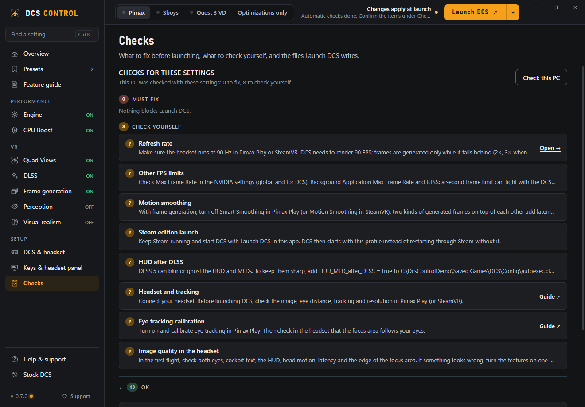

The **Checks** page lists every finding once:

- **Must fix** — blocks Launch DCS (each with a link to the fix).
- **Check yourself** — things only you can verify (refresh rate in Pimax Play/SteamVR, other FPS limiters, motion smoothing, eye calibration, image quality).
- **OK** — folded.

**Check this PC** adds the runtime, C++ runtime, drivers, write access and headset checks. **Save a text report** on the **Help & support** page saves a report file; the diagnostic package there holds it and the logs (see [Reporting a problem](#reporting-a-problem)). Below come the files Launch DCS will write and what was detected on this PC.

### Help & support

- **Diagnostic package**: **Create diagnostic package…** saves one ZIP to attach to a report (see [Reporting a problem](#reporting-a-problem)); *What's in the package* lists its contents. **Save a text report** saves the settings, the checks and what was detected on this PC as one file.
- **Headset panel messages**: what the headset panel's messages mean.
- **DLSS 5 on the focus area** (with DLSS 5 on): after a session, says whether DLSS 5 reached the Quad Views focus area and, when the panel said "DLSS 5: ON but not applied", why, in plain words, with what to check.
- **Updates**: the automatic check, **Check now**, **What's new in this version** and **Go back** to the previous version (see [Updates](#updates)).

### Stock DCS

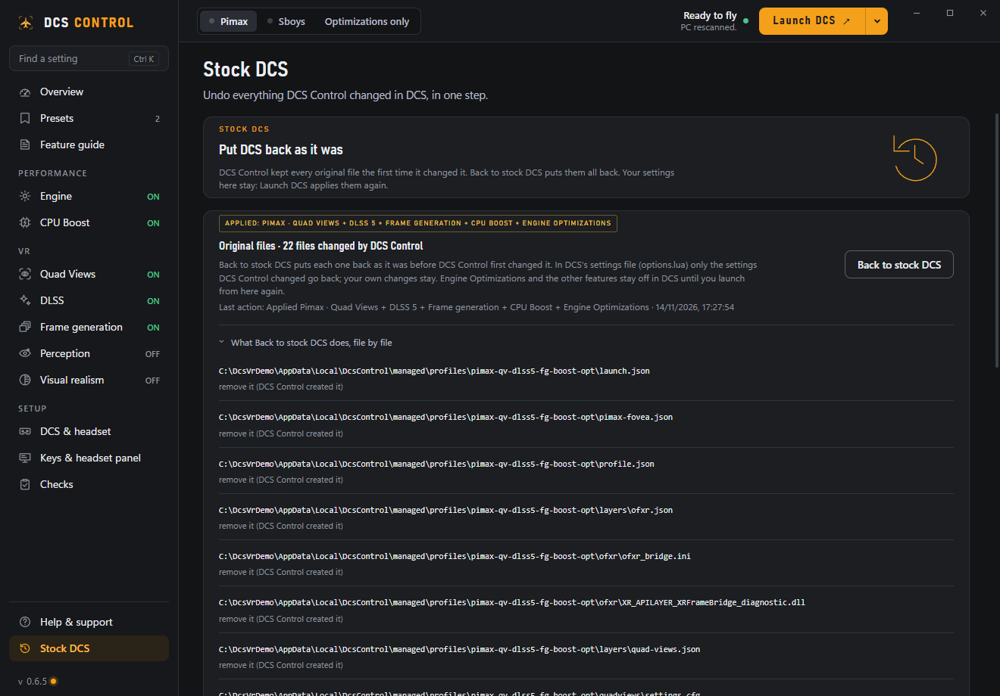

The **Stock DCS** page (last in the left rail) shows what is applied and, under *Original files*, how many files DCS Control changed, with one button: **Back to stock DCS**. It puts every file DCS Control ever changed back to what was there before:

- backups are written back,
- files that did not exist before are removed,
- in `options.lua`, only the settings DCS Control changed go back — your other edits stay.

Only a running DCS stops it. The folded list shows what will happen to each file. Use it **before repairing or updating DCS**, before uninstalling the app, or whenever you want plain DCS back. Backups live in `%LOCALAPPDATA%\DcsControl\originals` — keep that folder until you have restored.

**If that folder was lost** (Windows reinstalled, a cleaning tool, another user account), DCS Control's own files can still be in DCS: the DLSS 5 loader in `bin` keeps running even when DCS starts from Steam, and the Engine Optimizations hook keeps loading. The app recognises them by their exact bytes (every version it ever shipped), lists them on the Stock DCS page as *not in the record of originals*, warns on Checks, and Back to stock DCS removes them. A `dxgi.dll` of your own that DCS Control had chained as `dxgi2.dll` (ReShade, an overlay) gets its name back. A Cheeky, ReShade or other mod you installed yourself is never touched. What the lost backups held (a setting's old value in `options.lua`, another program's file that was set aside) cannot come back: set those by hand, or repair DCS.

## Launch DCS

Press **Launch DCS** (top bar, or the last step of Guided setup). With DCS closed, it:

1. **Checks** the profile (validation, file hashes, your Pimax Play values) — any error stops here, before anything is written.
2. **Applies what changed**: if your draft differs from what is installed, it writes the profile. The first time a file is written, the original is **backed up** (or noted as absent). If nothing changed, nothing is written. If only Pimax Play's values changed, only the focus area is updated.
3. **Starts DCS** directly (skipping the DCS launcher window) with its private VR settings, so only this DCS session uses the profile's layers. The CPU Boost helper starts with it if enabled.

The status line says **Ready to fly** (installed files match the draft), **Changes apply at launch**, or **DCS is running**.

Good to know:

- **Always start DCS with Launch DCS.** A Steam or desktop shortcut does not pass the profile's VR settings to DCS.
- **Steam edition: keep Steam running.** The app passes Steam's launch identifiers so DCS does not restart itself through Steam (which would lose the profile).
- **Don't run DCS or the app as administrator.** The VR loader ignores private settings in elevated processes; the app refuses to launch in that case.
- Only DLSS 5 and Foveated SR put files in DCS's `bin` folder. If another mod already has a `dxgi.dll` there (ReShade, an overlay), it keeps working: Launch DCS says so, asks once, backs it up and loads it after the DLSS 5 loader (as `dxgi2.dll`). If you prefer it off while flying with DLSS 5, choose **Set it aside** (or turn off *Keep another program's dxgi.dll working* on the DLSS page). **Back to stock DCS** puts the original back either way.

### Live changes while DCS runs

While DCS runs, settings tagged **LIVE** apply within about a second; you don't need to restart DCS. The **Live** switch in the top bar turns this off. The status line says what was applied and what waits for the next launch.

What applies live:

- **Engine Optimizations** (when DCS was started with them on): the individual optimizations, including the Model allocator, the GPU savings (**Faster terrain and shader paths**, which switched on in flight reaches its full gain within a few minutes of flying, **Cache distant shadows**, **Skip hidden water**, **Skip unused effects**), the in-flight switch and its beeps. Diagnostic hooks turn on live; turning them off waits for the next launch.
- **DLSS presets:** another letter for the Focus or Periphery DLSS preset is used from the next mission start. Turning a preset on or off waits for the next launch.
- **Visual realism:** color mode and its fine-tuning, panel color correction, night vision, glare, G vision and eye-focus blur, and the color mode key.
- **Perception:** Pupil shift, Depth boost and the eye distance value; Far depth's **Strength** and its key. Turning Far depth on or off waits.
- **Quad Views:** focus sharpening, focus edge blending, sharpening fade at the edge, periphery contrast, periphery stability, the four **Eye-tracking options**, and **Hide the focus edge** with its Fine-tune settings except Soft focus edge (while Soft focus edge is on, Hide the focus edge waits for the next launch too).
- **Headset panel:** its position, the FPS counter and the VRAM counter (whenever the headset panel or frame generation runs).
- **Frame generation:** optical flow resolution and bidirectional flow, and the Image quality **Fine-tune** settings (after this version has launched DCS once), only when DCS was started with NVIDIA frame generation (bidirectional flow waits with foveated frame generation). Optical flow quality waits for the next launch: changing it makes frame generation start its optical flow again, which froze DCS for several seconds.
- **DLSS 5:** the tuning settings (intensity, style, local tone and structure, skin, UI correction, automatic mask, color, transfer strength, paper white scale, Match brightness).
- **3D headphone audio:** every setting on the Audio page and its key, with an engine module that has 3D audio. Turning it on in VR waits for the next launch (the head pose comes with it), and so does a set imported after the launch.

A change to DLSS 5 intensity, style, local tone or structure, skin, UI correction or automatic mask, or to optical flow resolution or bidirectional flow, gives a short hitch in the headset (about half a second). This is normal.

Everything else waits for the next launch: focus size and shape, Soft focus edge, eye tracking, frame generation method and factor, Only when needed and Stop generating, Smoothness buffer, Both eyes at once, foveated frame generation, Sharp HUD, Smooth mouse cursor, optical flow quality, the DLSS 5 area and working scale, the headset panel key, CPU Boost and the flight helpers, and the DCS settings. If one change in a file needs a restart, every change in that file waits with it. Quad Views, frame generation and DLSS 5 apply live only after this version has launched the profile once; the settings new to live mode in 0.7 (the Eye-tracking options, Hide the focus edge, Far depth's strength and key, the headset panel) only after a 0.7 launch.

### The DCS launcher option

**Show the DCS launcher** (DCS & headset page, off by default) keeps DCS's own launcher window; press Play there. When you press Play, the DCS launcher restarts DCS and asks Windows to take it out of the "job" its parent runs in. If DCS Control itself was started by a program that puts its children in a restricted job (a script runner, an automation tool, some sandboxes), Windows refuses: DCS never opens and `dcs.log` ends with "… failed with error code 5". The app detects this, disables the option and explains why. **Opened from the Start menu or Explorer, the app is not in such a job and the launcher works.**

## Troubleshooting and FAQ

### Black screen in the headset / DCS hangs at the start of VR

1. Make sure you started DCS with **Launch DCS** from the app, not from Steam or a shortcut. Started any other way, DCS also loads other OpenXR layers such as VectorXR, which DCS Control turns off only for its own launches.
2. Open **Checks → Check this PC** and fix anything under *Must fix*. Look for **Other VR add-ons (OpenXR layers)** among the warnings: other OpenXR tools (overlays, older Quad Views or eye-tracking layers) load above the profile's layers and can break it. Disable them for the test.
3. Narrow it down: switch off **Frame generation**, launch; then add features back one at a time (Quad Views → Frame generation → DLSS 5).
4. If it still fails, **Back to stock DCS** and [report it](#reporting-a-problem) with the logs.

### DCS doesn't start

- **Steam edition:** Steam must be running.
- **Administrator:** don't run DCS or the app as administrator, and make sure `DCS.exe` has no "Run as administrator" compatibility flag. Checks flags both.
- **With "Show the DCS launcher" on:** if pressing Play does nothing and `dcs.log` ends with "error code 5", the app was started from inside another program's job. Close it and start it from the Start menu or Explorer, or turn the option off.
- **Write access:** if DCS is under `Program Files` and the profile uses DLSS 5 or Foveated SR, Launch DCS asks Windows once for permission to write to its `bin` folder (see [Access to the path … is denied](#access-to-the-path--is-denied-dcs-under-program-files)). Don't run the app as administrator instead.
- Read the status line and Checks: any error during Launch stops before DCS starts and says why.
- **A DCS still running in the background:** when DCS has had no window for a minute, or has not responded for several minutes, the status at the top of every page says so and offers **End DCS**. A second click confirms; a DCS that is only loading a mission would lose its progress. A DCS that crashed and still shows its crash window is named too (**DCS has crashed**): close that window, or use **End DCS**. A DCS running with administrator rights can only be ended with them: End DCS then asks Windows for permission.

### "Access to the path … is denied" (DCS under Program Files)

Windows protects `Program Files`: a normal program cannot write there, whatever the antivirus exclusions or the read-only flag say. With DLSS 5 or Foveated SR, DCS Control writes a few files into DCS's `bin` folder (the DLSS 5 loader and Cheeky's files), so when DCS is installed there, **Launch DCS asks Windows once** (its own prompt) to give your account Modify permission on that folder, then carries on. You can also do it beforehand from **Checks → Write access to game folders → Grant access**, or by hand: folder Properties → Security → Edit → your account → Modify. Don't run DCS Control as administrator instead: DCS would start elevated and ignore the profile's layers. If Windows Security's **Controlled folder access** is on, the check says so: allow DCS Control there (Ransomware protection → Allow an app through Controlled folder access).

### A rectangle or a spot flickers around the focus area

With **Foveated frame generation** on, test builds of 0.7 showed a flickering rectangle or spot, or a thin line, around the focus area on some Pimax setups. 0.7 joins the focus area and the rest of the view into one image before the headset gets it, which removes both; there is nothing to set. If you still see it, turn foveated frame generation off and please [report it](#reporting-a-problem).

### Quest 3: half the frame rate, or the route is not found

- **Half the frame rate**: turn off **Synchronous Spacewarp (SSW)** in the Virtual Desktop app. Checks reminds you on the Quest 3 VD route.
- **"Virtual Desktop's OpenXR runtime (VDXR) was not found"**: install the Virtual Desktop Streamer, then press **Check this PC**.
- **"Virtual Desktop is not streaming through VDXR"**: connect the Quest, and set the OpenXR runtime to VDXR in the Streamer app.
- **Read settings from this PC picks no route**: Virtual Desktop and Pimax Play are both running. Close the one you are not flying with and read again.
- **The refresh rate is refused**: the route takes 72, 80, 90 or 120 Hz. Pick the rate set in Virtual Desktop.

### An earlier version does not open my profile or preset

Versions before 0.7 (0.6.6, for example) refuse settings they do not know, and every profile or preset saved by 0.7 has some (for example Both eyes at once or the Quest 3 VD route). Use **Go back** on the Help & support page instead of installing the earlier version by hand: it gives that version the settings and presets you had in it (see [Updates](#updates)). A file exported from 0.7 can only be imported in 0.7 or later.

### Multi-threaded shadows and G-buffer are unavailable

They need D3D11 command lists on DCS's graphics device. Every recent NVIDIA card has them, so on NVIDIA the cause is almost always one of these, and the Engine Optimizations page says which:

- **NVIDIA Control Panel → Manage 3D settings → Antialiasing - MFAA is On**, in Global settings or in the DCS World program profile. Set it to **Off** (in the DCS profile: *Use global setting*). Checks warns about it before you launch; DCS Control reads this setting but never changes it.
- **DCS runs on the processor's integrated graphics** instead of the NVIDIA card: Windows Settings → System → Display → Graphics → DCS → High performance, or disable the integrated graphics.
- **A program hooked into DCS** created the device with threading optimizations off (overlays, ReShade-like tools, some OpenXR layers): try once without them.

*Threaded optimization* in NVIDIA Control Panel is not the cause: with it Off, a live test on an RTX 5090 (driver 32.0.16.2114) still had command lists (the module logged `DriverCommandLists=1`). The diagnostic package records the setting, but you do not need to change it for these optimizations.

On AMD cards the driver usually does not offer them. Everything else in the engine optimizations still runs.

**Multi-threading without driver support** (Engine Optimizations page, on by default): without driver command lists, Windows can stand in for them (it records the calls and replays them on DCS's render thread), and this switch lets both recorders run that way. The page shows it only where it can matter: on a PC whose graphics are AMD only, or when the module's last log says `DriverCommandLists=0`; with driver command lists it does nothing. It applies at the next DCS start. On a Radeon RX 7900 XTX it ran a whole flight without errors, and FPS dropped by about 7 % when the GPU-bound guard turned it off; when the GPU is the limit, the guard steps the recorders down by itself. On a PC with an NVIDIA card it runs only when something takes the card's own lists from DCS (MFAA on, DCS on integrated graphics, a program hooked into DCS); the Engine Optimizations page then says what to fix for the full gain. Profiles saved by 0.7.0 or earlier get it turned on once, the first time this version starts; after that your choice stays. On those PCs it writes `[Model] RecordersEmulatedLists=1` in `DcsQvCull.ini`; an empty file named `recorders_emulated_lists.flag` in `Saved Games\DCS\Scripts\DcsQvCull` turns it on as well (delete the file to go back). The recorders then upload their constants without buffer offsets, which was bit-exact against stock drawing in offline tests on Microsoft's software renderer (WARP); the recorders' same-frame verification (`[Suite] ShadowRecVerify`, `GBufferRecVerify`) works there too and turns a recorder off when it finds a difference. Expect a smaller gain than with driver command lists: the replay still costs the render thread about what DCS's own draw calls cost.

### ReShade (or another dxgi.dll mod) with DLSS 5

DLSS 5 and Foveated SR need the file name `dxgi.dll` in DCS's `bin` folder. When another program already has one there (ReShade, an overlay), Checks says so and Launch DCS asks once: **Keep it working** loads it after the DLSS 5 loader (as `dxgi2.dll`), **Set it aside** keeps it off while the profile is applied. It is backed up either way, and **Back to stock DCS** puts it back. If DCS misbehaves with both, turn off *Keep another program's dxgi.dll working* on the DLSS page.

### Framegen 3× feels laggy

3× renders only a third of the refresh rate (30 FPS at 90 Hz), so the latency is higher by design (about 88 ms vs about 55 ms in 2× measured on an earlier build) and fast sideways motion shows more artifacts. Options:

- Use **Auto 2×/3×** with **Only when needed** (the default) so frames are generated only while DCS falls behind, and 3× only while it can't hold half the refresh rate.
- Lower the load so DCS stays in 2×: smaller **DLSS 5 area**, lower **working scale**, smaller Quad Views focus or DCS graphics settings.
- In 2×, turning the **Smoothness buffer** off saves about one refresh (about 11 ms at 90 Hz), at the cost of more stutter when frame times jump.
- The Last flight card tells you how much time you spent in 2× and 3×.

### Engine Opt.: warming up

The headset panel shows "Engine Opt.: warming up 60%" (how far it is; the Engine Optimizations page shows "Shader warm-up: 120 of 200 ready") while the engine module compiles the shader variants it needs for what is on screen (shadow instancing). Until that is done, shadow instancing, batching, the texture skip and the recorders are only partly active, so the gain is smaller. The variants are kept in a cache on disk, so the first flights on a PC take longest (a few minutes on the test PC with an empty cache); later flights reuse them, and a new map or aircraft can warm up again briefly. Nothing is wrong, and the image is the same meanwhile. The cache is in DCS Control's own folder (`%LOCALAPPDATA%\DcsControl\engine-shader-cache`), not in the game or Saved Games, so **Back to stock DCS** keeps it and the next flight does not start from an empty cache; after a DCS update the changed variants are compiled again from the main menu on. **Clear cache** on the Engine Optimizations page (with DCS closed) or `DcsVr.Cli clear-shader-cache` deletes it. The module's log (`Saved Games\DCS\Scripts\DcsQvCull\DcsQvCull.log`) has a `warmup: done after … s` line with the cache hits.

### VRAM is full (stutters, textures loading late)

- Turn on the **VRAM counter** (Keys & headset panel page) to see it in the headset.
- On the CPU Boost page: **Free VRAM before flight**, **Small DCS window in VR**, **Lower the monitor while flying**. What Boost will do shows how much the listed programs hold now.
- Frame generation reserves a fixed amount of memory, sized by the headset image it receives; it does not grow during a flight. DCS's own texture and terrain settings are the other big lever.

### Multiplayer and Integrity Check

**At your own risk.** DCS Control is only tested in single player. With DLSS 5 or Foveated SR the app adds files to DCS's `bin` folder (`dxgi.dll`, Cheeky's files) and, with Engine Optimizations on, a hook and a module in `Saved Games\DCS\Scripts`. The same hook and module are also installed, with none of the optimizations running, for frame generation in VR, Depth boost, Far depth, the Visual realism effects and 3D headphone audio (which also patches DCS's sound engine in memory while DCS runs, in multiplayer too). Integrity Check has not been tested. If a server refuses you, **Back to stock DCS** before joining it, and please [report](#reporting-a-problem) what happened.

### DCS Control isn't in my list of OpenXR layers

That's expected. DCS Control doesn't register its layers (frame generation, Quad Views, Pupil shift / Depth boost) in Windows: it switches them on only for the DCS that **Launch DCS** starts. So tools that list the OpenXR layers registered on the PC don't show them, your other games aren't affected, and DCS started from Steam or a shortcut runs without them. In flight, the headset panel (Alt+Shift+F12) shows what is running.

### How do I uninstall?

1. Open the app and press **Back to stock DCS** (Stock DCS page) with DCS closed.
2. Uninstall **DCS Control** in **Settings → Apps → Installed apps**, or double-click `Uninstall DCS Control.exe` in the installed folder. Its window says what it removes (the application files after checking them, the shortcuts and the Apps entry). If DCS still has DCS Control's changes, it offers **Put DCS back to stock first** (on by default), so step 1 can be done there too. Your profiles and backups stay, unless you tick **Also delete my DCS Control profiles, settings and logs**. A copy installed with `Install DCS Control.cmd` uninstalls with `files\Uninstall.cmd`; a portable copy is just a folder: delete it.
3. To remove the profiles later by hand, delete `%LOCALAPPDATA%\DcsControl` (or `%LOCALAPPDATA%\DcsVrControl` if you used the app before 0.5.0), only after Back to stock DCS — it holds the backups.

The Sboys driver, if you installed it, is managed by its own tool.

### Does it change my DCS graphics settings?

Only the `options.lua` values a feature needs — the frame limit, desktop VSync, the DCS launcher setting, the small window if you enable it — and only when they differ. **Review files** lists every change before you launch, and **Back to stock DCS** puts them back. Everything else (DLSS quality, resolution, textures, shadows …) stays yours to set in DCS.

## Reporting a problem

Please open an issue on [GitHub](https://github.com/NIGos/dcs-control/issues) with:

1. **What you did and what happened** (route, features, 2×/3×/Auto, single-player or multiplayer).
2. **The diagnostic package:** open the **Help & support** page and press **Create diagnostic package…** right after the flight that went wrong, before starting DCS again (DCS starts its log anew). It saves one ZIP with everything needed to understand the problem: the app's report (profile, what was detected, the checks, the last flight), `dcs.log`, `options.lua`, the logs and settings of DLSS 5 (Cheeky), frame generation (OFXR), Quad Views, Pupil shift, the engine optimizations and CPU Boost, the DLSS and DirectX file versions in DCS's `bin` folder, Pimax Play's or SteamVR's logs and settings (Virtual Desktop's own logs are not in it yet), the OpenXR runtime and layers registered on the PC, and the Windows, CPU and GPU driver versions. Attach the ZIP to the issue.

> **Privacy:** the package holds only text files. Your Windows user name, PC name and e-mail addresses are replaced by `<user>`, `<pc>` and `<e-mail>`, and the account tokens, account ids and headset serial number in Pimax's logs are removed; nothing is sent anywhere. You can open the ZIP and look it over before posting.

**"DLSS 5: ON but not applied" in the headset?** The **Help & support** page reads the last DCS session and says whether DLSS 5 reached the Quad Views focus area, and if not, why (for example DCS running DLSS on images that are not the focus views, or another Quad Views layer in the way), with what to check.

## Support

DCS Control is free. If it improved your flying and you'd like to support the work: [ko-fi.com/nigos](https://ko-fi.com/nigos).
